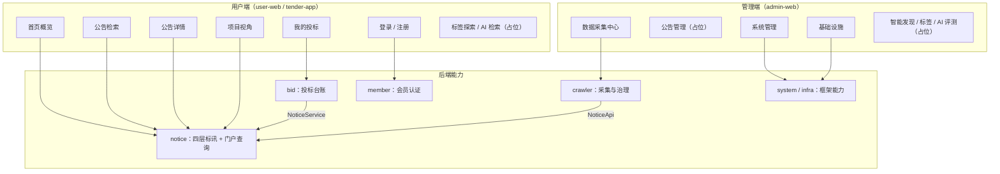

# 02 · 需求与功能

> 最后更新：2026-11-04

## 一、角色与权限

| 角色 | 访问入口 | 认证方式 | 主要能力 |
|---|---|---|---|
| 游客 | `user-web` / `tender-app` | 无 | 浏览公告、项目、统计、筛选项；查看详情 |
| 会员 | `user-web` / `tender-app` | `/app-api/member/auth/login` 获取 MEMBER Token | 游客能力 + 我的投标（创建、查看、状态流转） |
| 管理员 | `admin-web` | `/admin-api/system/auth/login` 获取 ADMIN Token | 系统管理、基础设施、采集站点/任务、代码生成等 |
| 定时任务 | 后端进程内 | `@TenantIgnore` | 每 2 小时触发采集 |
| 外部源站 | 公网 | 无 | 被采集的公开公告页面/JSON 接口 |

> 管理端与用户端令牌按 URL 前缀 + `UserTypeEnum` 双向隔离：`/admin-api` 只接受 ADMIN，`/app-api` 只接受 MEMBER。

## 二、功能架构

## 三、功能清单

### 3.1 用户端（已实现）

| 编号 | 功能 | 说明 | 状态 |
|---|---|---|---|
| U-01 | 首页概览 | 今日新增、公告总数、覆盖省份、行业数、项目数；最新 8 条；类型页签 | ✅ |
| U-02 | 公告分页检索 | 关键词、公告类型、省/市、行业、预算区间、发布时间范围 | ✅ |
| U-03 | 公告详情 | 四层关联信息、正文 HTML、附件直链、澄清记录、关联企业 | ✅ |
| U-04 | 筛选项 | 省级区划来自 `base_area`；行业来自已有公告的去重结果 | ✅ |
| U-05 | 项目列表 / 详情 | 以项目为主视角，聚合招标项目、标段、公告、企业 | ✅ |
| U-06 | 会员注册 / 登录 / 登出 | 账号密码 + 滑块验证码；注册成功自动登录 | ✅ |
| U-07 | 我的投标 | 创建投标、列表、详情、状态流转 | ✅ |
| U-08 | 投标状态机 | `SUBMITTED → OTB → WON/LOST`，任意非终态可 `ABANDONED` | ✅ |
| U-09 | 标签探索 | 页面骨架已建，接口与数据模型未落地 | ⛔ |
| U-10 | AI 语义检索 | 页面骨架已建，检索能力未落地 | ⛔ |
| U-11 | 收藏 | 页面骨架已建，收藏表与接口未落地 | ⛔ |

### 3.2 管理端（已实现 / 占位）

| 编号 | 功能 | 说明 | 状态 |
|---|---|---|---|
| A-01 | 采集中心 | 站点列表、手动触发、任务分页、最新任务 | ✅ |
| A-02 | 采集日志 | 抓取日志与字段核对页面 | 🚧 占位 |
| A-03 | 公告管理 | 公告列表/详情/运营视角 | 🚧 占位 |
| A-04 | 系统管理 | 用户、角色、菜单、字典、登录日志、操作日志 | ✅ |
| A-05 | 会员管理 | user-web 会员列表、启停、重置密码 | ✅ |
| A-06 | 基础设施 | 定时任务、配置、文件、代码生成、API 日志 | ✅ |
| A-07 | 智能站点发现 | 候选站点审核 | ⛔ 占位 |
| A-08 | 标签管理 | 标签管理与自动打标 | ⛔ 占位 |
| A-09 | AI 检索评测 | 检索效果评测 | ⛔ 占位 |

### 3.3 后端能力（已实现）

| 编号 | 能力 | 说明 |
|---|---|---|
| B-01 | 多源采集 | 适配器模式；列表 → 详情两段式 |
| B-02 | 四层归并 | 按 `source_url` 去重，按 `project_key` 归并项目 |
| B-03 | 企业主体 | 名称归一 + 哈希去重；角色与公告关联 |
| B-04 | 数据质量 | 缺失字段、解析异常、质量状态 |
| B-05 | 采集治理 | 频道配置、逐 URL 日志、原始快照、归并日志 |
| B-06 | 门户查询 | 公告/项目分页与详情，批量组装避免 N+1 |
| B-07 | 投标台账 | 冗余公告关键信息，状态机校验 |
| B-08 | 会员认证 | 复用 system 的 OAuth2 Token 体系 |

## 四、非功能需求

| 类别 | 要求 | 当前实现 |
|---|---|---|
| 性能 | 公告列表 P95 < 500ms（本地数据量） | 索引 + 批量组装；列表不返回正文/附件 |
| 可用性 | 采集失败不影响门户读 | 采集异步；任务失败只记录状态 |
| 幂等 | 重复采集不产生重复公告 | `uk_source_url` + upsert |
| 并发 | 同一站点不并发采集 | 单线程执行器 + RUNNING 任务检查 |
| 可观测 | 每轮采集可追溯 | `crawler_task` / `crawler_fetch_log` / `crawl_raw` |
| 安全 | 管理接口需令牌；门户匿名只读 | Spring Security + `@PermitAll` 白名单 |
| 合规 | 只采公开信息、限速、不绕过访问控制 | 见 [13 安全与合规](13-安全与合规.md) |
| 兼容 | API 契约冻结后只加不改 | `NoticeApi` 契约；旧扁平接口已删除 |

## 五、业务边界与非目标

1. **不做预测**：不提供「提前 N 月独家预测项目」类能力。
2. **不做撮合**：不提供「找关系合作投标」、不干预评审。
3. **不下载附件**：只保存附件直链与元信息，下载行为发生在源站。
4. **不采非公开数据**：不模拟登录、不使用账号凭据、不绕过验证码。
5. **不做附件二次分发**：平台不是文件分发方。
6. **不承诺全网覆盖**：当前为「政府采购全国覆盖 + 工程建设等公共资源类别初步覆盖」。

## 六、验收口径

- 门户：首页、列表、详情、项目详情均可匿名访问并返回四层模型数据。
- 采集：手动触发一轮后，`crawler_task` 有 SUCCESS/FAILED 记录，新增/更新计数可核对。
- 归并：`notice_with_project / notice_with_tender_project / notice_with_lot` 等于 `notice_total`。
- 投标：非法状态迁移返回 `1_070_100_002`；重复创建同一公告投标返回 `1_070_100_001`。
- 会员：登录返回 MEMBER Token；`get-profile` 未带 Token 返回 401。
- 管理端：采集接口匿名访问返回 401。
