# 03 · 系统架构

> 最后更新：2026-11-04

## 一、架构原则

1. **单体多模块**：一个 Spring Boot 进程，按业务域拆 Maven 模块；模块间通过 `api` 包或 Spring Bean 调用，不跨模块直接访问 DAL。
2. **分层清晰**：`controller`（入参/出参）→ `service`（业务）→ `dal`（DO/Mapper），DO 不直接暴露给前端。
3. **读写路径分离**：采集通过 `NoticeApi.upsert` 写入；门户通过 `NoticeService` / `ProjectService` 读取；写模型与读视图由 `NoticeIngestionService` / `NoticeViewAssembler` 分别负责。
4. **配置驱动**：站点、频道、编码、区划落表；新增源站尽量不改主干代码。
5. **幂等优先**：采集按 `source_url` 去重；项目按 `project_key` 归并；企业按名称哈希去重。
6. **原始层可追溯**：`crawl_raw` 只增不改，`crawler_fetch_log` 记录每个 URL 的结果。
7. **项目未上线，不保留兼容包袱**：P0-6 已删除旧列，旧接口不保留。

## 二、总体架构



> 源文件：[architecture.mmd](diagrams/architecture.mmd)

### 2.1 分层说明

| 层 | 组件 | 职责 |
|---|---|---|
| 接入层 | `admin-web` / `user-web` / `tender-app` | 管理端、用户端、移动端页面与交互 |
| 接口层 | Spring MVC、Spring Security、`CommonResult`、全局异常、Knife4j | 路由、鉴权、参数校验、统一返回、接口文档 |
| 业务层 | notice / crawler / bid / member | 标讯、采集、投标、会员 |
| 框架层 | system / infra + `tender-framework` starters | RBAC、字典、日志、OAuth2、文件、任务、MyBatis、Redis、Excel |
| 数据层 | MySQL `tender`、Redis、公开源站 | 持久化、缓存/锁、采集目标 |

### 2.2 请求入口

| 前缀 | 使用者 | 令牌类型 | 说明 |
|---|---|---|---|
| `/admin-api/**` | 管理端 | ADMIN | 系统/基础设施/采集管理 |
| `/app-api/**` | 用户端 / 移动端 | MEMBER | 会员认证、投标、规划中的 AI/标签接口 |
| `/admin-api/notice/**` | 游客 + 前端 | 匿名 | 门户公告/项目查询；类上有 `@PermitAll` + `@TenantIgnore` |
| `/actuator/**` | 运维 | 无 / 按环境 | 健康检查与监控 |
| `/admin` | Spring Boot Admin | admin/admin（本地） | 监控 UI |
| `/doc.html` | 开发 | 无 | Knife4j 接口文档 |

## 三、模块依赖



> 源文件：[module-dependency.mmd](diagrams/module-dependency.mmd)

| 模块 | 职责 | 依赖 |
|---|---|---|
| `tender-server` | 启动、聚合、打包 | 所有业务模块 |
| `tender-module-system` | 用户/角色/菜单/字典/日志/OAuth2 | framework |
| `tender-module-infra` | 配置、文件、定时任务、代码生成、API 日志 | framework |
| `tender-module-notice` | 四层标讯、企业主体、基础数据、门户查询 | system |
| `tender-module-crawler` | 源站适配器、调度、采集治理 | notice |
| `tender-module-bid` | 投标台账、状态机 | notice |
| `tender-module-member` | 会员认证 | system |
| `tender-module-discovery` | 站点发现（占位） | 无 |
| `tender-module-ai` | AI 检索/标书（占位） | notice |
| `tender-module-tag` | 标签体系（占位） | notice |

**依赖规则**

- `crawler` 只能通过 `NoticeApi` 写公告，不能直接依赖 notice 的 Mapper/DO。
- `bid` 只能通过 `NoticeService` 读公告，不直接查 `notice` 表。
- `notice` 不反向依赖 `crawler` / `bid`。
- 占位模块不得引入新的生产依赖，等能力落地再补。

## 四、部署拓扑



> 源文件：[deployment.mmd](diagrams/deployment.mmd)

### 4.1 单机部署（当前）

| 组件 | 默认地址 | 说明 |
|---|---|---|
| 后端 | `http://127.0.0.1:48080` | Spring Boot 单体 |
| MySQL | `127.0.0.1:3306` | 库 `tender` |
| Redis | `127.0.0.1:6379` | 缓存、验证码、锁 |
| 管理端 | `http://127.0.0.1:80` | Vite dev / Nginx 静态 |
| 用户端 | `http://127.0.0.1:3001` | Vite dev |
| 移动端 H5 | `dist/build/h5` | UniApp 构建产物 |

### 4.2 生产建议

```text
用户浏览器 / 移动端
        │
        ▼
   Nginx（443 / 80）
   ├── /            → admin-web / user-web 静态文件
   ├── /admin-api/  → 127.0.0.1:48080
   └── /app-api/    → 127.0.0.1:48080
        │
        ▼
   tender-server（单实例）
   ├── MySQL 8（主从可选）
   └── Redis（单机 / 哨兵）
```

- 采集与 Web 同进程，当前为单实例；多实例部署前必须把采集调度改为分布式锁或独立 worker。
- 附件不落盘，不需要对象存储；如后续落盘，走 `infra_file`。

## 五、技术选型

| 领域 | 选型 | 理由 |
|---|---|---|
| Web 框架 | Spring Boot 3.5 | 成熟、生态完整、与 RuoYi 框架兼容 |
| ORM | MyBatis-Plus | 单表 CRUD 高效，便于按查询条件拼装 |
| 数据库 | MySQL 8 | 团队熟悉、部署简单、JSON 字段可用 |
| 缓存 | Redis + Redisson | 验证码、Token、分布式锁 |
| 定时 | Spring `@Scheduled` | 采集任务简单，2 小时一轮，无需 Quartz 的持久化调度 |
| 接口文档 | Knife4j | 中文 UI，调试方便 |
| 管理端 | Vue 3 + Element Plus | 与 RuoYi 后台生态一致，组件丰富 |
| 用户端 | Vue 3 + Vite | 轻量、构建快、SEO 友好（可后续 SSR） |
| 移动端 | UniApp | 一套代码出 H5 / App |
| CI | GitHub Actions | 与托管仓库集成，零额外成本 |

## 六、关键架构决策（ADR）

### ADR-01：单体多模块，而不是微服务

- **背景**：毕业设计团队规模小，部署资源有限。
- **决策**：一个 Spring Boot 进程，Maven 模块划分边界。
- **收益**：部署简单、调试链路短、事务本地化。
- **代价**：模块边界靠约定与依赖方向约束；采集与 Web 同进程。
- **后续**：采集量大时可拆为独立 worker；模块已按域拆分，拆分成本可控。

### ADR-02：四层标讯模型，而不是单张扁平表

- **背景**：同一项目会发布招标、变更、中标等多条公告，单表无法表达项目/标段关系。
- **决策**：`project → tender_project → tender_lot → notice` 四层，公告通过外键关联。
- **收益**：项目视角聚合、公告变更追溯、企业关联、跨源归并。
- **代价**：写入需保证四层骨架完整；读路径需批量组装避免 N+1。
- **实现**：`NoticeIngestionService` + `NoticeViewAssembler`。

### ADR-03：适配器模式 + 两段式采集

- **背景**：各源站列表/详情结构差异大，且列表页可能分页、详情页可能反爬。
- **决策**：`SourceAdapter` 接口；每个源站实现「列表页 → 详情页 → NoticeDTO」。
- **收益**：新增源站只加适配器 + 配置，不改采集主干。
- **代价**：每个源站需单独维护解析器与测试。
- **实现**：`ccgp`、`ggzy`、`ztb_gz`。

### ADR-04：`NoticeApi` 作为唯一写入口

- **背景**：早期去重/入库逻辑在多个适配器重复。
- **决策**：适配器只产出 `NoticeDTO`，统一调用 `NoticeApi.upsert`。
- **收益**：去重、四层骨架、企业关联、质量记录只实现一次。
- **代价**：DTO 字段变更需同步所有适配器。
- **实现**：`NoticeApiImpl` → `NoticeIngestionService`。

### ADR-05：项目未上线，直接删除旧列

- **背景**：P0 重构完成，项目从未上线，无历史数据包袱。
- **决策**：P0-6 直接删除 `notice` 旧列，不保留双写/兼容层。
- **收益**：代码与表结构干净，无历史字段判断。
- **代价**：P0-2/P0-3 回填脚本只能在 P0-6 之前执行。
- **实现**：`P0-6__drop_legacy_columns.sql`。

## 七、扩展性设计

| 扩展点 | 做法 |
|---|---|
| 新增源站 | 实现 `SourceAdapter` + 在 `crawler_site` / `crawler_channel` 加配置 |
| 新增公告字段 | `NoticeDTO` → `NoticePortalDO` → `notice` 表 → `NoticeRespVO` → 前端类型 |
| 新增业务模块 | 新建 `tender-module-xxx`，在 `tender-server/pom.xml` 与根 `pom.xml` 注册 |
| 新增管理端页面 | `system_menu` 插菜单 + `admin-web/src/views` 放页面 |
| 新增用户端页面 | `user-web/src/router` 加路由 + `views` 放页面 |
| 新增定时任务 | 优先 `@Scheduled`；需要管理端可见时改用 `infra_job` + Quartz |
| 多实例部署 | 采集调度加分布式锁，或拆独立 worker；Token/验证码已走 Redis |
