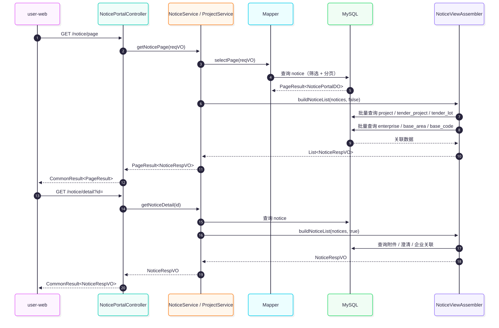

# 04 · 后端设计

> 最后更新：2026-11-04

## 一、工程结构

```text
backend/
├── tender-server/                 # 启动类、application*.yaml、打包入口
├── tender-framework/              # 公共 starters：common / web / security / mybatis / redis / excel / ...
├── tender-module-system/          # 用户、角色、菜单、字典、OAuth2、日志
├── tender-module-infra/           # 配置、文件、定时任务、代码生成、API 日志
├── tender-module-member/          # 会员认证
├── tender-module-notice/          # 四层标讯、企业主体、基础数据、门户查询
├── tender-module-crawler/         # 源站适配器、调度、采集治理
├── tender-module-bid/             # 投标台账
├── tender-module-discovery/       # 站点发现（占位）
├── tender-module-ai/              # AI 能力（占位）
└── tender-module-tag/             # 标签体系（占位）
```

### 1.1 单模块内部包结构

```text
com.tenderintelligence.module.<domain>/
├── api/                 # 对外暴露的跨模块契约（DTO + 接口）
├── controller/
│   ├── admin/           # /admin-api 管理端
│   └── app/             # /app-api 用户端
├── service/             # 业务接口与实现
├── dal/
│   ├── dataobject/      # DO，@TableName 映射
│   └── mysql/           # Mapper，继承 BaseMapperX
├── enums/               # 枚举与 ErrorCodeConstants
└── framework/           # 模块内配置（少量）
```

**约束**

- Controller 只做参数校验、调用 Service、包装 `CommonResult`，不写业务逻辑。
- Service 之间可以互相调用；跨模块优先走 `api` 包接口，不直接注入对方 Mapper。
- DO 不直接返回给前端；出参统一用 `VO` / `DTO`。
- Mapper 只做数据访问，复杂 SQL 用 `LambdaQueryWrapperX` 或 `@Select`，不把业务判断塞进 SQL。

## 二、模块职责

| 模块 | 核心职责 | 关键类 |
|---|---|---|
| `tender-module-notice` | 四层标讯、企业主体、基础数据、门户读接口 | `NoticePortalController`、`NoticeService`、`NoticeIngestionService`、`NoticeViewAssembler`、`ProjectService` |
| `tender-module-crawler` | 源站适配、调度、采集治理 | `CrawlService`、`SourceAdapter`、`ScheduledCrawlTask`、`CrawlTelemetryService` |
| `tender-module-bid` | 投标台账与状态机 | `BidPortalController`、`BidProjectService`、`BidProjectStatusEnum` |
| `tender-module-member` | 会员注册/登录/资料 | `MemberAuthController`、`MemberAuthService` |
| `tender-module-system` | RBAC、字典、OAuth2、登录/操作日志 | 框架提供，业务按需复用 |
| `tender-module-infra` | 配置、文件、定时任务、代码生成、API 日志 | 框架提供 |
| `tender-module-discovery` | 站点发现（占位） | 仅 `package-info` |
| `tender-module-ai` | 语义检索/AI（占位） | 仅 `package-info` |
| `tender-module-tag` | 标签体系（占位） | 仅 `package-info` |

## 三、notice 领域设计

### 3.1 读写分离

```text
写：SourceAdapter → NoticeApi.upsert(NoticeDTO)
      → NoticeIngestionService
      → notice / project / tender_project / tender_lot / enterprise* / notice_quality / crawl_merge_log

读：NoticePortalController → NoticeService / ProjectService
      → Mapper 查询主表
      → NoticeViewAssembler 批量补齐 project / tender_project / tender_lot / enterprise / base_area / base_code
      → NoticeRespVO / ProjectRespVO
```

### 3.2 关键类

| 类 | 职责 |
|---|---|
| `NoticeApi` / `NoticeApiImpl` | 跨模块写入口：`upsert(NoticeDTO)`；读 DTO 供其它模块使用 |
| `NoticeIngestionService` | 唯一采集写入口：去重、四层骨架、企业、质量、归并日志 |
| `NoticeService` / `NoticeServiceImpl` | 门户公告分页、详情、统计、省市/行业选项 |
| `ProjectService` / `ProjectServiceImpl` | project-centric 分页与详情 |
| `NoticeViewAssembler` | 批量组装公告/项目视图，避免 N+1 |
| `NoticePortalMapper` | 公告查询（筛选、分页、按项目批量） |

### 3.3 写入规则

1. 以 `source_url` 为唯一去重键；不存在则插入，存在且关键字段变化则更新。
2. 变更检测覆盖：标题、项目编号、行业、预算、联系人、正文、发布时间、开标时间、区域码、公告类型、投标截止、来源平台、省/市代码，以及解析器明确产出的国标字段。
3. 附件整组重写：先删后写，源站删除的附件不会残留。
4. 新公告或骨架不完整时同步四层模型；`project_id` / `tender_project_id` / `lot_id` 任一为空都会触发。
5. 项目按 `SHA256(项目编号或标题 | region_code | 项目编号)` 归并；无标段时生成 `lot_no='DEFAULT'`。
6. 企业名称归一化：去空格/全角空格/换行/制表符，全角括号转半角，截断 256 字符，SHA256 作为 `name_hash`。
7. 每次写入计算缺失字段，写 `notice_quality`；正文有内容则质量状态为 `PARTIAL`（缺字段）或 `OK`，标题为空为 `BROKEN`。
8. 归并记录 `crawl_merge_log`：优先 `UNIFIED_CODE`，其次 `PROJECT_NO_NOTICE_ID`，最后 `SOURCE_URL`。

## 四、crawler 设计

### 4.1 结构

```text
CrawlerController（/crawler）
  → CrawlService.run(siteCode, triggerType)
    → CrawlerSiteMapper / CrawlerTaskMapper
    → SourceAdapter（按 site.code 匹配）
      → 列表页 → 详情页 → 解析 NoticeDTO
      → CrawlTelemetryService（crawler_fetch_log / crawl_raw）
      → NoticeApi.upsert
```

### 4.2 关键类

| 类 | 职责 |
|---|---|
| `CrawlService` / `CrawlServiceImpl` | 任务创建、防重入、单线程异步执行、状态更新 |
| `SourceAdapter` | 源站适配器契约：`code()` + `crawl(site, stats)` |
| `ScheduledCrawlTask` | 每 2 小时触发全站点采集；受 `tender.crawler.schedule-enabled` 控制 |
| `CrawlerChannelMapper` | 读取启用的频道配置（替代 `crawler_site.channels` JSON） |
| `CrawlTelemetryService` | 写逐 URL 日志与原始快照 |
| `CrawlerTaskMapper` | 任务分页、最新任务、RUNNING 数、超时任务回收 |

### 4.3 并发与容错

- 单线程 `ExecutorService`，同一进程内采集串行，避免并发打爆源站。
- 每轮开始时把超过 4 小时的 `RUNNING` 任务标记失败，避免进程崩溃后永久阻塞。
- 站点已有 `RUNNING` 任务时跳过本轮提交。
- 适配器异常只影响当前站点任务，不影响其它站点和门户读。
- 采集结果写入 `CrawlerStats`：列表抓取、列表解析、详情成功/失败、新增、更新。

## 五、bid 设计

### 5.1 状态机


> 源文件：[bid-state.mmd](diagrams/bid-state.mmd)

| 当前状态 | 允许迁移 |
|---|---|
| `SUBMITTED` | `OTB`、`ABANDONED` |
| `OTB` | `WON`、`LOST`、`ABANDONED` |
| `WON` / `LOST` / `ABANDONED` | 终态，不可迁移 |

### 5.2 规则

- 创建时读取源公告，冗余 `title`、`bidDeadline`；公告不存在抛 `NOTICE_NOT_EXISTS`。
- 同一用户对同一公告存在 `SUBMITTED` / `OTB` 项目时，拒绝重复创建。
- 查询/更新时校验 `userId`，防止越权。
- 非法迁移抛 `BID_PROJECT_STATUS_ILLEGAL`。

## 六、member 设计

- 复用 system 模块的 OAuth2 Token 体系，令牌类型 `MEMBER`。
- 登录/注册需滑块验证码；`tender.captcha.enable=false` 可在本地关闭。
- 注册成功后自动签发令牌。
- 密码使用 `PasswordEncoder`（BCrypt）存储。
- `/app-api/member/auth/login|register|logout` 匿名；`get-profile` 需要 MEMBER Token。

## 七、system / infra 使用约定

- 管理端认证：`/admin-api/system/auth/login`；菜单/权限由 `system_menu` 驱动。
- 字典：业务枚举优先放 `base_code`（区划/编码集）或 Java 枚举；管理端下拉走 `system_dict_*`。
- 定时任务：采集使用 Spring `@Scheduled`，不出现在 `infra_job`；框架自带清理任务走 Quartz。
- 文件：附件不落盘；如后续需要落盘，使用 `infra_file` 而不是自建表。
- 日志：API 访问/异常日志由框架写入 `infra_api_*`；业务日志用 `@Slf4j`，不重复打印全局异常。

## 八、接口清单

### 8.1 业务接口

| 模块 | 方法 | 路径 | 鉴权 | 说明 |
|---|---|---|---|---|
| notice | GET | `/admin-api/notice/page` | 匿名 | 公告分页 |
| notice | GET | `/admin-api/notice/detail?id=` | 匿名 | 公告详情（含附件/澄清/企业） |
| notice | GET | `/admin-api/notice/overview` | 匿名 | 首页统计 |
| notice | GET | `/admin-api/notice/provinces` | 匿名 | 省级区划 |
| notice | GET | `/admin-api/notice/industries` | 匿名 | 行业选项 |
| notice | GET | `/admin-api/notice/project/page` | 匿名 | 项目分页 |
| notice | GET | `/admin-api/notice/project/detail?id=` | 匿名 | 项目详情 |
| crawler | POST | `/admin-api/crawler/run?siteCode=` | ADMIN | 触发采集（异步） |
| crawler | GET | `/admin-api/crawler/site/list` | ADMIN | 站点列表 |
| crawler | GET | `/admin-api/crawler/task/page` | ADMIN | 任务分页 |
| crawler | GET | `/admin-api/crawler/task/latest?siteCode=` | ADMIN | 最新任务 |
| bid | POST | `/app-api/bid-project/create` | MEMBER | 创建投标 |
| bid | GET | `/app-api/bid-project/list?status=` | MEMBER | 我的投标 |
| bid | GET | `/app-api/bid-project/get?id=` | MEMBER | 投标详情 |
| bid | POST | `/app-api/bid-project/status` | MEMBER | 状态流转 |
| member | POST | `/app-api/member/auth/login` | 匿名 | 登录 |
| member | POST | `/app-api/member/auth/register` | 匿名 | 注册 |
| member | POST | `/app-api/member/auth/logout` | 匿名 | 登出 |
| member | GET | `/app-api/member/auth/get-profile` | MEMBER | 个人信息 |

> 完整参数与响应见 [08 接口设计规范](08-接口设计规范.md)。系统/基础设施接口由框架提供，不在本文逐条列出。

### 8.2 公告查询时序



> 源文件：[notice-read-flow.mmd](diagrams/notice-read-flow.mmd)

## 九、错误码

错误码为 9 位整数，格式：`1-XXX-XXX-XXX`。业务模块区间：

| 模块 | 区间 | 示例 |
|---|---|---|
| member | `1_004_000_000` ~ | `1_004_000_001` 用户名已存在 |
| notice | `1_060_001_000` ~ | `1_060_001_000` 公告不存在；`1_060_002_000` 项目不存在 |
| bid | `1_070_100_000` ~ | `1_070_100_000` 投标不存在；`1_070_100_001` 重复投标；`1_070_100_002` 状态非法 |
| crawler | `1_080_100_000` ~ | `1_080_100_000` 站点不存在；`1_080_100_001` 站点未启用 |

约定：

- 每个模块一个 `ErrorCodeConstants` 接口，错误码只增不改。
- 业务异常统一 `throw exception(ErrorCode)`，由全局异常处理器转成 `CommonResult`。
- 前端只依赖 `code` 判断，不解析 `msg` 做逻辑。

## 十、并发、幂等与事务

| 场景 | 机制 |
|---|---|
| 采集重入 | `crawler_task` RUNNING 检查 + 单线程执行器 |
| 公告重复 | `uk_source_url` + `selectBySourceUrl` + 更新而非插入 |
| 项目重复 | `uk_project_key` + `DuplicateKeyException` 兜底查询 |
| 企业重复 | `name_hash` 唯一 + 冲突后重查 |
| 公告-企业关联 | `(notice_id, enterprise_id, role_code)` 唯一 |
| 投标重复 | `selectActiveByUserAndNotice` 查在办项目 |
| 写入事务 | `NoticeIngestionService.upsert` 标注 `@Transactional` |

## 十一、扩展点

1. **新增源站**：实现 `SourceAdapter`，在 `crawler_site` 插一行、`crawler_channel` 插频道。
2. **新增字段**：同步 `NoticeDTO` → `NoticePortalDO` → `notice` DDL → `NoticeRespVO` → 前端 `types.ts`。
3. **新增读接口**：Controller → Service → Mapper；涉及多表时在 `NoticeViewAssembler` 批量取数。
4. **新增业务模块**：新建 Maven 模块，根 `pom.xml` 与 `tender-server/pom.xml` 注册；包名 `com.tenderintelligence.module.<domain>`。
5. **新增管理端页面**：`system_menu` 插菜单，`admin-web/src/views/<path>/index.vue` 放页面。
