# 05 · 数据模型与 ER 图

> 最后更新：2026-11-04  
> 数据库：MySQL 8.x · `tender`  
> DDL 真源：`backend/sql/mysql/notice.sql`（最终结构）；`backend/sql/mysql/refactor/` 仅保留历史迁移记录。

## 一、建模原则

1. **四层标讯**：`project → tender_project → tender_lot → notice`，公告是事实记录，项目是聚合对象。
2. **代码化**：地区、公告类型、采购方式、企业角色存代码；中文名由 `base_area` / `base_code` 关联或前端字典渲染。
3. **缺失可表达**：源站没有的字段用 `NULL`；解析失败写 `notice_quality` / `missing_fields`。
4. **原始层不可变**：`crawl_raw` 只增不改，规范化表可重放解析。
5. **判重有优先级**：统一交易标识码 > 标段编号 > 项目编号 + 公告标识 > 源站 URL。
6. **幂等写入**：采集 upsert、企业哈希、公告-企业关联都有唯一键。
7. **逻辑删除**：业务表统一 `deleted bit(1)`；查询默认过滤。
8. **无物理外键（业务表）**：关联由应用层维护；仅 Quartz 表有物理外键。

## 二、核心 ER 图



> 源文件：[er-core.mmd](diagrams/er-core.mmd)  
> 图中只画核心业务表与主要关系；完整字段见 §四、§五。

## 三、领域划分

| 域 | 表 |
|---|---|
| 基础数据 | `base_area`、`base_code`、`base_field_mapping` |
| 标讯四层 | `project`、`tender_project`、`tender_lot`、`notice` |
| 公告附属 | `notice_attachment`、`notice_change`、`notice_enterprise`、`notice_quality` |
| 企业主体 | `enterprise`、`enterprise_role`、`enterprise_contact`、`enterprise_alias` |
| 采集治理 | `crawler_site`、`crawler_channel`、`crawler_task`、`crawler_fetch_log`、`crawl_raw`、`crawl_parse_rule`、`crawl_merge_log` |
| 用户业务 | `bid_project`、`member_user` |
| 框架 | `system_*`、`infra_*`、`QRTZ_*` |

## 四、核心表说明

### 4.1 `project` —— 项目数据集

| 字段 | 类型 | 说明 |
|---|---|---|
| `id` | bigint PK | 项目 ID |
| `project_key` | varchar(128) UK | 归并键：`SHA256(项目编号或标题 \| region_code \| 项目编号)` |
| `unified_deal_code` | varchar(64) | 统一交易标识码 |
| `project_no` | varchar(128) | 项目编号 |
| `project_name` | varchar(512) | 项目名称 |
| `trade_category_code` | varchar(32) | 交易分类（工程建设/政府采购/…） |
| `region_code` / `province_code` / `city_code` / `district_code` | varchar | 行政区划 |
| `budget` | decimal(18,2) | 预算（万元） |
| `tenderer_enterprise_id` / `agency_enterprise_id` | bigint | 招标人/代理机构 |
| `status` | varchar(16) | `ACTIVE` / `OFFLINE` |
| `first_publish_time` / `last_publish_time` | datetime | 首/末次公告时间 |
| `notice_count` / `lot_count` / `source_count` | int | 聚合统计 |
| `missing_fields` | json | 缺失字段 |
| `data_quality_status` | varchar(16) | `OK` / `PARTIAL` / `BROKEN` / `UNKNOWN` |

索引：`uk_project_key`、`uk_unified_deal_code`、`idx_project_no`、`idx_region_category (region_code, trade_category_code)`、`idx_last_publish`。

### 4.2 `tender_project` —— 招标项目

| 字段 | 说明 |
|---|---|
| `project_id` | 所属项目 |
| `tender_project_no` | 招标项目编号 |
| `tender_project_name` | 招标项目名称 |
| `procurement_method_code` | 采购方式 |
| `budget` / `price_ceiling` | 预算/最高限价 |
| `lot_count` | 标段数 |
| `contract_period_days` / `contract_period_text` | 工期 |
| `qualification_summary` | 资格摘要 |
| `evaluation_method_code` | 评标办法 |
| `tenderer_enterprise_id` / `agency_enterprise_id` | 主体 |
| `region_code` | 行政区划 |
| `publish_time` / `status` | 发布时间/状态 |

索引：`uk_project_no (project_id, tender_project_no)`、`idx_project`、`idx_region_publish`。

### 4.3 `tender_lot` —— 标段

| 字段 | 说明 |
|---|---|
| `tender_project_id` / `project_id` | 所属招标项目/项目 |
| `lot_no` | 标段编号；无标段时为 `DEFAULT` |
| `lot_name` / `lot_content` | 名称/内容 |
| `budget` / `price_ceiling` / `deposit_amount` | 金额 |
| `qualification_requirement` / `specific_qualification` | 资格要求 |
| `consortium_allowed` | 是否接受联合体 |
| `performance_requirement` | 业绩要求 |
| `qualification_level_code` | 资质等级 |
| `evaluation_method_code` | 评标办法 |
| `region_code` / `status` | 区划/状态 |

索引：`uk_tender_project_lot (tender_project_id, lot_no)`、`idx_project`、`idx_region`。

### 4.4 `notice` —— 公告（事实表）

| 分组 | 字段 |
|---|---|
| 关联 | `project_id`、`tender_project_id`、`lot_id` |
| 标识 | `unified_deal_code`、`project_no`、`tender_project_no`、`lot_no`、`notice_no` |
| 类型 | `notice_type_code`、`notice_subtype_code` |
| 内容 | `title`、`content`、`source_url`、`source_site_code`、`source_platform` |
| 时间 | `publish_time`、`file_get_start_time`、`file_get_end_time`、`qa_deadline`、`sign_deadline`、`bid_deadline`、`open_time`、`publicity_start_time`、`publicity_end_time` |
| 金额 | `budget`、`price_ceiling`、`deposit_amount`、`file_price`、`win_amount` |
| 采购 | `procurement_method_code`、`funding_source_code`、`evaluation_method_code` |
| 资格 | `qualification_requirement`、`specific_qualification`、`consortium_allowed`、`performance_requirement`、`qualification_level_code` |
| 地区 | `region_code`、`province_code`、`city_code`、`district_code` |
| 主体 | `tenderer_enterprise_id`、`agency_enterprise_id`、`winner_enterprise_id` |
| 业务 | `industry`（规则抽取）、`industry_code`、`contact`、`contact_phone` |
| 治理 | `has_attachment`、`view_count`、`status`、`missing_fields`、`data_quality_status`、`raw_id`、`parser_version` |

索引：`uk_source_url`、`idx_notice_type_publish`、`idx_notice_project`、`idx_notice_tender_project`、`idx_notice_lot`、`idx_notice_region_publish`、`idx_notice_unified_code`、`idx_notice_project_no`、`idx_notice_lot_no`、`idx_notice_bid_deadline`、`idx_notice_source_site_time`、`idx_publish_time`、`idx_industry`。

> 旧列 `type` / `province` / `city` / `tender_person` / `agency` / `deadline` / `source` 已由 P0-6 删除。

### 4.5 `notice_attachment` —— 附件

`notice_id`、`file_name`、`file_url`（源站直链）、`file_type`、`file_size`、`sort`、`file_category_code`、`file_price`、`acquisition_method_code`、`source_attachment_id`、`file_hash`、`local_file_id`。

> 平台不存文件本体；`local_file_id` 预留给未来落盘。

### 4.6 `notice_change` —— 澄清/变更

`notice_id`、`change_type_code`、`change_title`、`change_content`、`change_time`、`source_url`、`raw_id`。

### 4.7 `notice_enterprise` —— 公告-企业关联

`notice_id`、`enterprise_id`、`role_code`（`TENDERER` / `AGENCY` / `WINNER` / `SUPPLIER`）、`source_text`、`confidence`、`status`。

唯一键：`(notice_id, enterprise_id, role_code)`。

### 4.8 `enterprise` —— 企业主体

| 字段 | 说明 |
|---|---|
| `name` / `normalized_name` / `name_hash` | 原名/归一名/名称哈希（普通索引） |
| `unified_social_credit_code` | 统一社会信用代码（可空） |
| `enterprise_type_code` / `legal_person` / `registered_capital` | 工商信息 |
| `region_code` / `province_code` / `city_code` / `district_code` | 地区 |
| `industry_code` | 行业 |
| `contact_name` / `contact_phone` / `email` / `website` | 联系方式 |
| `source_type` / `source_url` | 来源 |
| `status` / `merged_to_id` | 状态/合并目标 |

### 4.9 `enterprise_role` / `enterprise_contact` / `enterprise_alias`

- `enterprise_role`：企业角色（`TENDERER` / `AGENCY` / `SUPPLIER` / `WINNER`），记录首次/最近出现的公告。
- `enterprise_contact`：企业联系人，记录来源公告与置信度。
- `enterprise_alias`：企业别名，用于同名/简称归并。

## 五、采集治理表

### 5.1 `crawler_site` —— 站点配置

`code`（唯一）、`name`、`enabled`、`config`（baseUrl/UA/initialUrl 等）、`interval_ms`、`tier`、`priority`、`region_scope`、`last_success_time`、`last_fail_time`、`health_status`、`adapter_version`。

> `channels` 旧 JSON 列保留作历史配置，代码不再读取；频道以 `crawler_channel` 为准。

### 5.2 `crawler_channel` —— 频道配置

`site_code`、`path`、`name`、`notice_type_code`、`page_count`、`schedule_cron`、`enabled`、`sort`、`config`。唯一键 `(site_code, path, notice_type_code)`。

### 5.3 `crawler_task` —— 采集任务

`site_code`、`start_time`、`end_time`、`status`（`RUNNING`/`SUCCESS`/`FAILED`）、`list_fetched`、`list_parsed`、`detail_fetched`、`detail_failed`、`new_insert`、`updated`、`error_msg`、`trigger_type`、`duration_ms`、`config_snapshot`、`error_type`、`data_date`。

### 5.4 `crawler_fetch_log` —— 逐 URL 日志

`task_id`、`site_code`、`channel_path`、`page_type`（`LIST`/`DETAIL`）、`url`、`http_status`、`duration_ms`、`retry_count`、`status`、`error_type`、`error_msg`、`fetched_at`。

### 5.5 `crawl_raw` —— 原始页面快照

`task_id`、`site_code`、`source_url`、`page_type`、`content_hash`、`content`、`content_encoding`、`parser_version`、`parse_status`、`fetched_at`。

> 只增不改；用于重放解析与审计。当前开发库为 0 行（功能刚接入，尚无新采集轮次）。

### 5.6 `crawl_parse_rule` / `crawl_merge_log` / `notice_quality`

- `crawl_parse_rule`：解析规则版本（P1 规划，当前未使用）。
- `crawl_merge_log`：归并记录（`source_notice_id`、`target_project_id`、`match_type`、`status`、`detail`）。
- `notice_quality`：公告质量问题（`issue_type`、`field_name`、`severity`、`status`）。

## 六、基础数据表

### 6.1 `base_area`

`code`（GB/T 2260）、`parent_code`、`level`（1 省 / 2 市 / 3 区县）、`name`、`short_name`、`full_name`、`pinyin`、`region_type`、`valid_from`、`valid_to`、`enabled`、`sort`。

> 当前只导入 34 个省级 + 17 个演示城市；完整地市/区县需导入 GB/T 2260 数据文件。

### 6.2 `base_code`

`code_set`、`code`、`name`、`parent_code`、`level`、`sort`、`enabled`、`remark`。唯一键 `(code_set, code)`。

当前编码集：`enterprise_role`、`notice_type`、`notice_subtype`、`procurement_method`、`funding_source`、`qualification_level`、`evaluation_method`、`consortium_flag`、`file_category`、`amount_unit`、`push_channel`、`trade_category`。

### 6.3 `base_field_mapping`

源站字段 → 标准表/标准字段的映射，P0 只建表，未预置数据；用于后续配置化解析。

## 七、用户业务表

### 7.1 `member_user`

`username`（唯一）、`password`（BCrypt）、`nickname`、`mobile`、`avatar`、`status`、`login_ip`、`login_date`。

> 会员表不参与租户维度；`tenant.enable=false`。

### 7.2 `bid_project`

`user_id`、`notice_id`、`project_name`（冗余）、`deadline`（冗余）、`bid_amount`、`bid_file_name`、`status`、`remark`。

索引：`idx_user`、`idx_notice`。

## 八、关系与基数

| 关系 | 基数 | 说明 |
|---|---|---|
| project → tender_project | 1:N | 一个项目可有多次招标 |
| project → tender_lot | 1:N | 标段直接挂项目，便于聚合 |
| tender_project → tender_lot | 1:N | 标段属于招标项目 |
| project → notice | 1:N | 项目下的所有公告 |
| tender_project → notice | 1:N | 招标项目下的公告 |
| tender_lot → notice | 1:N | 标段下的公告 |
| notice → notice_attachment | 1:N | 附件整组重写 |
| notice → notice_change | 1:N | 澄清/变更 |
| notice ↔ enterprise | M:N | 通过 `notice_enterprise` |
| enterprise → enterprise_role/contact/alias | 1:N | 角色/联系人/别名 |
| crawler_site → crawler_channel | 1:N | 频道配置 |
| crawler_site → crawler_task | 1:N | 采集任务 |
| crawler_task → crawler_fetch_log/crawl_raw | 1:N | 逐 URL 日志/快照 |
| notice → notice_quality | 1:N | 质量问题 |
| member_user → bid_project | 1:N | 会员投标 |
| notice → bid_project | 1:N | 投标来源 |

## 九、索引设计

| 表 | 索引 | 用途 |
|---|---|---|
| `notice` | `uk_source_url` | 采集去重 |
| `notice` | `idx_notice_type_publish` | 列表主路径 |
| `notice` | `idx_notice_project` / `idx_notice_tender_project` / `idx_notice_lot` | 项目聚合 |
| `notice` | `idx_notice_region_publish` | 区域筛选/订阅 |
| `notice` | `idx_notice_unified_code` / `idx_notice_project_no` / `idx_notice_lot_no` | 判重 |
| `notice` | `idx_notice_bid_deadline` | T-3/T-1 提醒（规划） |
| `project` | `uk_project_key` | 归并幂等 |
| `project` | `uk_unified_deal_code` | 统一交易码唯一 |
| `tender_project` | `uk_project_no (project_id, tender_project_no)` | 项目内招标编号唯一 |
| `tender_lot` | `uk_tender_project_lot` | 标段唯一 |
| `enterprise` | `idx_name_hash` / `uk_credit_code` | 名称检索 / 信用代码唯一 |
| `notice_enterprise` | `uk_notice_enterprise_role` | 关联幂等 |
| `crawler_channel` | `uk_site_path_type` | 频道唯一 |

## 十、数据字典（核心枚举）

| 字段 | 值 | 含义 |
|---|---|---|
| `notice.notice_type_code` | `tender` / `win` / `change` / `explore` / `qualify` | 招标/中标/变更/采购/资格预审 |
| `notice.status` | `ACTIVE` / `OFFLINE` | 有效/下线 |
| `data_quality_status` | `OK` / `PARTIAL` / `BROKEN` / `UNKNOWN` | 质量状态 |
| `notice_enterprise.role_code` | `TENDERER` / `AGENCY` / `SUPPLIER` / `WINNER` | 企业角色 |
| `notice_quality.issue_type` | `MISSING_FIELD` / `PARSE_ERROR` | 问题类型 |
| `notice_quality.severity` | `WARN` / `ERROR` | 严重度 |
| `bid_project.status` | `SUBMITTED` / `OTB` / `WON` / `LOST` / `ABANDONED` | 投标状态 |
| `crawler_task.status` | `RUNNING` / `SUCCESS` / `FAILED` | 任务状态 |
| `crawler_task.trigger_type` | `MANUAL` / `SCHEDULE` / `RETRY` | 触发方式 |
| `crawl_merge_log.match_type` | `UNIFIED_CODE` / `PROJECT_NO_NOTICE_ID` / `SOURCE_URL` | 归并依据 |

## 十一、当前数据量与缺口

> 开发库已清空业务数据，等待按新规范重新采集；如需演示数据，执行 `demo-data.sql`（可选）。下表为当前快照。

| 表 | 行数（约） |
|---|---|
| `notice` | 0（等待重新采集） |
| `project` | 0 |
| `tender_project` / `tender_lot` | 0 / 0 |
| `enterprise` / `enterprise_role` | 0 / 0 |
| `notice_enterprise` | 0 |
| `notice_attachment` | 0 |
| `crawler_site` / `crawler_channel` | 3 / 35 |
| `base_area` / `base_code` | 51 / 53 |

缺口：

- 业务数据已清空，等待重新采集。
- 演示数据可通过 `demo-data.sql` 单独导入（20 条公告 + 四层关联 + 40 个企业）。
- `crawl_raw` / `crawler_fetch_log` 当前为 0：等待下一轮采集写入。

## 十二、初始化与迁移

```bash
# 新库：tender.sql 自建库并 USE tender
mysql -uroot -p < backend/sql/mysql/tender.sql

# 业务最终结构 + 基础/站点/菜单种子（业务表为空）
mysql -uroot -p < backend/sql/mysql/notice.sql

# 可选：20 条演示公告 + 四层关联
mysql -uroot -p < backend/sql/mysql/demo-data.sql
```

> `notice.sql` 已直接创建 P0 终态结构，**不需要再执行 `refactor/P0__run_all.sh`**。  
> `refactor/` 仅用于已存在库的历史迁移记录。

详见 [12 部署与运维](12-部署与运维.md) 与 `backend/sql/mysql/refactor/README.md`。
