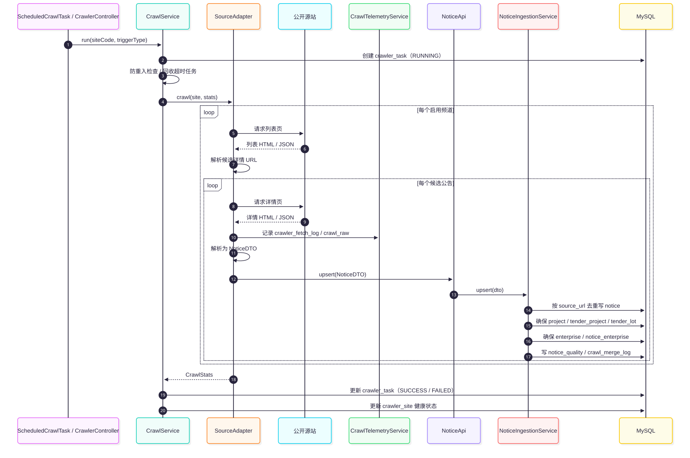

# 06 · 数据采集设计

> 最后更新：2026-11-04  
> 代码：`backend/tender-module-crawler/`

## 一、目标与边界

**目标**

- 多源、可配置、可扩展地采集公开招投标公告。
- 两段式采集：列表页取候选 → 详情页取字段。
- 采集与业务解耦：适配器只产出 `NoticeDTO`，入库统一走 `NoticeApi.upsert`。
- 可追溯：每轮任务、每个 URL、每个原始页面都有记录。

**边界**

- 只采公开页面/公开 JSON 接口，不模拟登录、不绕过验证码。
- 附件只存直链与元信息，不下载文件本体。
- 不追求实时，默认每 2 小时一轮，要求「不漏」优先于「最快」。

## 二、源站与频道

| 站点 | code | 状态 | 频道数 | 说明 |
|---|---|---|---|---|
| 中国政府采购网 | `ccgp` | ✅ 启用 | 22 | `dfgg` 地方公告 11 个 + `zygg` 中央公告 11 个；HTML 正则解析 |
| 全国公共资源交易平台 | `ggzy` | ✅ 启用 | 10 | 表单 POST JSON 列表 + 服务端直出详情；正文可得率低，空正文跳过 |
| 贵州省招标投标公共服务平台 | `ztb_gz` | ⛔ 停用 | 3 | JSON API；源站列表接口返回 0 条，适配器与配置保留，改 `enabled=b'1'` 可恢复 |

> 频道配置以 `crawler_channel` 为准；`crawler_site.channels` JSON 仅作历史配置保留。

## 三、采集流程



> 源文件：[crawl-flow.mmd](diagrams/crawl-flow.mmd)

### 3.1 触发方式

| 方式 | 入口 | 说明 |
|---|---|---|
| 定时 | `ScheduledCrawlTask` | `tender.crawler.schedule-cron`，默认 `0 0 */2 * * ?` |
| 手动 | `POST /admin-api/crawler/run?siteCode=` | 需 ADMIN Token；异步执行，立即返回任务号 |
| 重试 | `run(siteCode, "RETRY")` | 预留，当前无自动重试调度 |

### 3.2 执行步骤

1. 回收超过 4 小时的 `RUNNING` 任务（进程崩溃遗留）。
2. 选择站点：指定 `siteCode` 或所有 `enabled` 站点。
3. 防重入：站点已有 `RUNNING` 任务则跳过。
4. 创建 `crawler_task`（`RUNNING`），提交到单线程执行器。
5. 适配器遍历启用频道：列表页 → 候选 URL → 详情页 → 解析 → `NoticeApi.upsert`。
6. 统计写入 `CrawlerStats`，更新任务状态与站点健康状态。

## 四、适配器契约

```java
public interface SourceAdapter {
    String code();
    void crawl(CrawlerSiteDO site, CrawlStats stats) throws Exception;
}
```

实现类：

| 实现 | 站点 | 解析器 |
|---|---|---|
| `CcgpSourceAdapter` | `ccgp` | `CcgpNoticeParser`（地方）/ `CcgpZyggNoticeParser`（中央），共用 `CcgpHtmlSupport` |
| `GgzySourceAdapter` | `ggzy` | `GgzyNoticeParser` + `GgzyHtmlSupport` |
| `GuizhouZtbSourceAdapter` | `ztb_gz` | `GuizhouZtbNoticeParser` |

**适配器职责**

- 读取 `crawler_channel` 的启用频道。
- 列表页抓取与翻页；详情页抓取与解析。
- 产出 `NoticeDTO`，调用 `NoticeApi.upsert`。
- 通过 `CrawlTelemetryService` 记录逐 URL 日志与原始快照。
- 更新 `CrawlStats`：`listFetched` / `listParsed` / `detailFetched` / `detailFailed` / `newInsert` / `updated`。

**禁止**

- 适配器直接操作 `notice` / `project` / `enterprise` Mapper。
- 在适配器内复制去重/归并逻辑。
- 在适配器内吞掉异常导致任务假成功。

## 五、解析与字段映射

`NoticeDTO` 是适配器与入库层之间的契约。解析器字段与库列映射：

| 解析器字段 | 入库列 | 说明 |
|---|---|---|
| `noticeTypeCode` | `notice.notice_type_code` | `tender` / `win` / `change` / `explore` / `qualify` |
| `provinceName` / `cityName` | `province_code` / `city_code` | 中文名用于匹配 `base_area` |
| `tendererName` / `agencyName` | `enterprise` + `notice_enterprise` | 名称归一后匹配/创建企业 |
| `bidDeadline` | `notice.bid_deadline` | 投标截止 |
| `sourcePlatform` | `notice.source_platform` | 来源平台 |
| `industry` | `notice.industry` | 规则抽取结果，非权威标签 |
| `regionCode` | `notice.region_code` | 源站原始地区码 |
| `content` | `notice.content` | 正文 HTML 片段 |
| `attachments` | `notice_attachment` | 整组重写 |

> 旧扁平列已删除；解析器输出直接对应新模型。

## 六、入库、去重与变更

### 6.1 去重

- 唯一键：`notice.source_url`。
- `selectBySourceUrl` 查询；存在则更新，不存在则插入。
- 同一公告跨源站不合并；跨源归并依赖 `project_key` / 统一交易码，记录在 `crawl_merge_log`。

### 6.2 变更检测

比较字段：

- 标题、项目编号、行业、预算、联系人、联系电话、正文、发布时间、开标时间、区域码。
- 公告类型、投标截止、来源平台、省/市代码。
- 统一交易码、最高限价、保证金、采购方式、资格要求（仅 DTO 明确产出时比较）。
- 附件整组（URL / 文件名 / 大小）。

无变化：不写库、不计数。  
有变化：更新公告 + 重写附件 + 同步四层模型；`stats.updated++`。

### 6.3 四层骨架

- `project_key = SHA256(项目编号或标题 | region_code | 项目编号)`。
- 项目不存在则创建；存在则补全预算/主体/首末公告时间。
- `tender_project` 按项目取第一个；不存在则创建。
- `tender_lot` 按 `(tender_project_id, lot_no)` 唯一；无标段时 `lot_no='DEFAULT'`。
- 公告写入 `project_id` / `tender_project_id` / `lot_id`。

### 6.4 企业主体

- 名称归一：去空格/全角空格/换行/制表符，全角括号转半角，截断 256。
- `name_hash = SHA256(normalized_name)`；`uk_name_hash` 防重。
- 角色写 `enterprise_role`；公告关联写 `notice_enterprise`。
- 冲突（同名不同主体）当前不自动合并，保留 `merged_to_id` 供人工处理。

## 七、采集治理

| 表 | 写入方 | 作用 |
|---|---|---|
| `crawler_task` | `CrawlServiceImpl` | 每轮任务状态与统计 |
| `crawler_fetch_log` | `CrawlTelemetryService` | 逐 URL 抓取结果、耗时、错误 |
| `crawl_raw` | `CrawlTelemetryService` | 原始页面快照（只增不改） |
| `notice_quality` | `NoticeIngestionService` | 缺失字段/解析异常 |
| `crawl_merge_log` | `NoticeIngestionService` | 公告 → 项目/招标项目/标段的归并记录 |

### 7.1 质量状态

- 标题为空：`BROKEN`。
- 有缺失字段：`PARTIAL`。
- 无缺失：`OK`。
- 未计算：`UNKNOWN`。

缺失字段包括：`unified_deal_code`、`trade_category_code`、`procurement_method_code`、`qualification_requirement`、`deposit_amount`、`file_get_start_time`、`file_get_end_time`。

## 八、调度、并发与容错

| 项 | 策略 |
|---|---|
| 调度 | Spring `@Scheduled`，默认每 2 小时；`tender.crawler.schedule-enabled=false` 关闭 |
| 并发 | 单线程执行器，站点串行 |
| 防重入 | 站点存在 `RUNNING` 任务则跳过 |
| 超时回收 | 超过 4 小时的 `RUNNING` 任务标记失败 |
| 限速 | 站点 `interval_ms`（默认 3000ms）控制详情页间隔 |
| 失败 | 当前站点任务 `FAILED`，记录 `error_type` / `error_msg`；不影响其它站点 |
| 健康度 | 成功 `HEALTHY`，失败 `DEGRADED`，未知 `UNKNOWN` |

## 九、新增源站步骤

1. 在 `tender-module-crawler/service/adapter/<site>/` 新建 `XxxSourceAdapter`，实现 `SourceAdapter`。
2. 新建 `XxxNoticeParser`（或复用现有解析器），产出 `NoticeDTO`。
3. 在 `crawler_site` 插入站点配置（`code`、`name`、`config`、`interval_ms`）。
4. 在 `crawler_channel` 插入频道（`site_code`、`path`、`name`、`notice_type_code`、`page_count`）。
5. 为解析器补单元测试（参考 `GgzyNoticeParserTest`）。
6. 用 `POST /admin-api/crawler/run?siteCode=xxx` 验证：
   - 任务 `SUCCESS`；
   - `listFetched > 0`、`listParsed > 0`；
   - `detailFailed` 在可接受范围；
   - `newInsert` / `updated` 符合预期；
   - `notice.source_url` 可在浏览器打开。

## 十、已知缺口

| 项 | 说明 |
|---|---|
| `ggzy` 正文可得率 | 工程建设约 7/10、政府采购约 2/10、国有产权 0/10；空正文记录跳过 |
| `ztb_gz` | 源站列表接口返回 0 条，已停用；源码与配置保留 |
| 全量区划 | `base_area` 只有省级 + 17 个演示城市，`city_code` 大量为空 |
| 多标段 | 解析器尚未稳定产出真实标段，默认生成 `DEFAULT` 标段 |
| 自动重试 | 当前无自动重试调度；失败需手动重跑 |
| 跨源归并 | 依赖统一交易码/项目编号，冲突进 `crawl_merge_log`，人工合并未实现 |

## 十一、合规要点

- 采集前检查源站 `robots.txt`，`Disallow` 路径不采。
- 限速：详情页默认 3 秒间隔，单线程串行。
- 不模拟登录、不使用账号凭据、不绕过验证码。
- 只存公告正文片段与附件直链，不下载、不再分发附件。
- 保留 `source_url` 与 `source_platform`，每条数据可回源核对。
