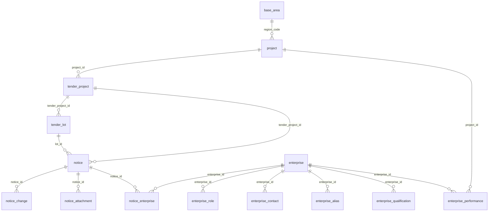
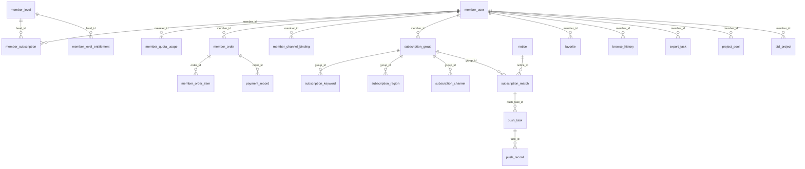
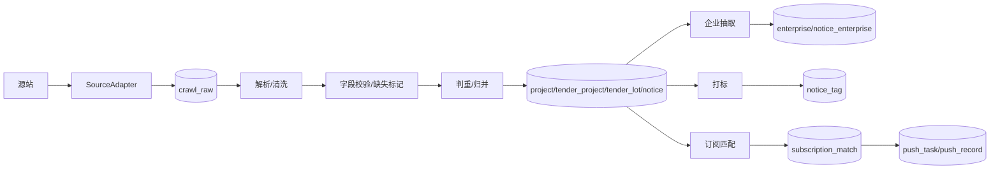

# 数据模型 —— 目标设计（V2.0 对齐 + 商业化）

> 编制：2026-11-03
> 状态：**P0 已落地，旧列已删除**。P0 增量脚本见 `backend/sql/mysql/refactor/`，读路径与采集写入均已切到四层模型；本文其余部分仍是目标设计。
>
> 2026-11-04 更新：项目从未上线，P0-6 直接删除 `notice` 旧列（`type`/`province`/`city`/`tender_person`/`agency`/`deadline`/`source`），不保留兼容。`notice.industry` 保留为 crawler 规则抽取的业务字段，国标代码在 `industry_code`。
> 定位：把「发改委《公共资源交易平台系统数据规范 V2.0》字段固化 + 企业主体 + 基础数据 + 会员订阅/推送/投标闭环」整理成一套可评审的目标模型。
> 与现有文档的关系：
> - [`07-数据模型-现状.md`](07-数据模型-现状.md)：当前真实存在的表，本文的迁移起点；
> - [`08-数据模型-规划.md`](08-数据模型-规划.md)：旧的竞品页面驱动规划。本文**取代 08 作为目标模型**，08 保留作历史参考；
> - [`09-数据源清单.md`](09-数据源清单.md)：源站清单与采集可达性。
>
> **评审通过后再产出 DDL。** DDL 按 P0 → P1 → P2 分批产出，每批附回滚脚本，不一次性重建库。

---

## 一、设计目标与边界

### 1.1 目标

| 编号 | 目标 | 对应咨询要求 |
|---|---|---|
| G1 | 采集字段按 V2.0 固化，区分国标基础字段与业务扩展字段 | 咨询（一） |
| G2 | 采集链路与主业务解耦，具备原始层、清洗层、调度与重试 | 咨询（二） |
| G3 | 新增企业信息管理，支撑业主/代理机构/供应商画像 | 咨询（三） |
| G4 | 预置行政区划（GB/T 2260）与 V2.0 编码字典 | 咨询（四） |
| G5 | 支撑会员套餐、权益、配额、订阅、推送、导出、API、子账号 | 原始需求 |
| G6 | 支撑投标工作台、资格匹配、AI 标书、情报分析 | 原始需求 |
| G7 | 具备数据质量、变更历史、判重归并、原始快照能力 | 本文补充 |

### 1.2 非目标（本版不做）

- 不在本文写建表 SQL、迁移脚本或 Java DO；
- 不引入分库分表；高增长日志表只约定保留与分区策略；
- 不做真实支付渠道对接细节（只定义订单/支付/退款的落库模型）；
- 不做跨平台项目归并的算法实现（只定义结果表与判重优先级）；
- 不改变现有 `tender-server` 的鉴权、租户裁剪方式（沿用单租户、`tenant_id = 0`），子账号模型单独设计。

### 1.3 设计原则

1. **国标字段与业务字段分层**：国标基础字段放标讯域主表，业务扩展字段（提醒、订阅、AI、运营）放业务表或 `*_ext` 表，不污染国标列。
2. **代码化而非中文名**：地区、交易分类、采购方式、企业角色等一律存代码，中文名由 `base_area` / `base_code` 关联或前端字典渲染。
3. **缺失可表达**：源站没有的字段用 `NULL`，不用空字符串冒充；`missing_fields` + `notice_quality` 记录缺失与解析问题。
4. **原始层不可变**：`crawl_raw` 只增不改，规范化表可重放解析。
5. **判重有优先级**：统一交易标识码 > 标段编号 > 项目编号 + 公告标识 > 源站 URL。
6. **配置驱动**：站点、频道、解析规则、套餐权益、字典均落表配置，不写死在代码里。
7. **权益快照**：会员订阅时保存当时的权益快照，套餐改版不影响老会员。
8. **幂等写入**：采集 upsert、配额计数、订阅匹配、推送都要有唯一键或幂等键。
9. **复用框架能力**：`system_dict_type/data`、`infra_job`、`infra_file`、`system_notify_*`、`system_oauth2_*`、`infra_api_access_log` 不重复造。
10. **可回滚**：每张新表附带来源、迁移方向、回滚策略；旧字段在迁移期保留。

---

## 二、现状差距摘要

| 咨询/需求 | 现状 | 差距结论 | 本文对应 |
|---|---|---|---|
| V2.0 字段固化 | `notice` 单表 21 个业务字段，项目/主体/资格/时间全揉在一行 | 缺项目-招标项目-标段-公告四层模型；缺 20+ 国标字段 | §八 |
| 采集解耦独立 | Maven 模块与主服务同进程，`@Scheduled` 直接写业务表 | 缺原始层、逐 URL 日志、调度配置、重试、判重日志 | §七 |
| 企业信息管理 | `tender_person` / `agency` 是自由文本 | 缺企业主表、联系人、角色、信用代码、别名、公告关联 | §九 |
| 基础数据预留 | `province`/`city` 存中文名，`region_code` 自由文本；字典无 V2.0 项 | 缺行政区划表、编码集、字段映射 | §六 |
| 会员套餐 | `member_user` 无等级、到期、配额 | 缺套餐、权益、订阅、订单、配额、渠道、子账号、API | §十 |
| 消息推送 | 框架只有站内信模板/消息 | 缺渠道绑定、订阅匹配、推送任务/记录、T-3/T-1 提醒 | §十一 |
| 投标工作台 | 只有 `bid_project` 五状态机 | 缺项目池、投标文件、模板、资格匹配 | §十二 |
| 情报分析 | 无 | 缺合同、项目进度、监控、企业分析、报告 | §十三 |
| 标签/站点发现/AI | `tag` / `discovery` / `ai` 模块为空包 | 三块均无表 | §十三 |

> **旧规划 08 的问题**：`bid_info` 是一张 25 字段的扁平表，仍把项目、主体、时间、资格压在一行；且没有行政区划、企业信用代码、套餐权益、配额、渠道绑定、提醒、导出、API、标签、AI。因此不能直接照 08 建表。

---

## 三、领域划分与表清单

### 3.1 领域划分

| 域 | 职责 | 主要表 |
|---|---|---|
| 基础数据域 | 行政区划、标准编码、源站字段映射 | `base_area`、`base_code`、`base_field_mapping` |
| 采集治理域 | 站点/频道配置、任务、逐 URL 日志、原始快照、解析规则、归并日志、质量 | `crawler_*`、`crawl_*`、`notice_quality` |
| 国标标讯域 | 项目、招标项目、标段、公告、澄清、附件、公告-企业 | `project`、`tender_project`、`tender_lot`、`notice*` |
| 企业主体域 | 企业、角色、联系人、别名、资质、业绩 | `enterprise*`、`member_enterprise` |
| 会员商业化域 | 套餐、权益、订阅、配额、订单、支付、渠道、子账号、API | `member_level*`、`member_subscription`、`member_order*`、`member_quota_usage` 等 |
| 订阅推送域 | 关键词组、区域、渠道、匹配结果、推送任务/记录、提醒 | `subscription_*`、`push_*`、`reminder_task` |
| 用户业务域 | 收藏、浏览、查看计数、导出、项目池、投标文件、资格匹配 | `favorite`、`browse_history`、`project_pool`、`bid_*` |
| 情报与 AI 域 | 合同、项目进度、监控、企业分析、报告、标签、站点发现、AI 标书/评测 | `contract`、`monitor*`、`tag*`、`discovery*`、`ai_*` |

### 3.2 表清单总表

> 状态：**复用** = 框架已有直接用；**扩展** = 现有表加列；**重构** = 保留表名但调整字段；**新建** = 新增表；**可选** = 评审后再定。

| 域 | 表名 | 中文 | 状态 | 优先级 |
|---|---|---|---|---|
| 基础 | `base_area` | 行政区划 | 新建 | P0 |
| 基础 | `base_code` | 标准编码集 | 新建 | P0 |
| 基础 | `base_field_mapping` | 源站字段映射 | 新建 | P0 |
| 采集 | `crawler_site` | 爬虫站点配置 | 扩展 | P0 |
| 采集 | `crawler_channel` | 采集频道配置 | 新建 | P0 |
| 采集 | `crawler_task` | 采集任务日志 | 扩展 | P0 |
| 采集 | `crawler_fetch_log` | 逐 URL 抓取日志 | 新建 | P0 |
| 采集 | `crawl_raw` | 原始页面快照 | 新建 | P0 |
| 采集 | `crawl_parse_rule` | 解析规则版本 | 新建 | P1 |
| 采集 | `crawl_merge_log` | 判重/归并日志 | 新建 | P0 |
| 采集 | `notice_quality` | 公告数据质量 | 新建 | P0 |
| 标讯 | `project` | 项目数据集 | 新建 | P0 |
| 标讯 | `tender_project` | 招标项目数据集 | 新建 | P0 |
| 标讯 | `tender_lot` | 标段（包）数据集 | 新建 | P0 |
| 标讯 | `notice` | 公告数据集 | 重构/扩展 | P0 |
| 标讯 | `notice_change` | 澄清修改 | 新建 | P0 |
| 标讯 | `notice_attachment` | 公告附件 | 扩展 | P0 |
| 标讯 | `notice_enterprise` | 公告-企业关联 | 新建 | P0 |
| 标讯 | `notice_snapshot` | 公告快照（审计） | 新建 | P2 |
| 企业 | `enterprise` | 企业主体 | 新建 | P0 |
| 企业 | `enterprise_role` | 企业角色 | 新建 | P0 |
| 企业 | `enterprise_contact` | 企业联系人 | 新建 | P0 |
| 企业 | `enterprise_alias` | 企业别名 | 新建 | P0 |
| 企业 | `enterprise_qualification` | 企业资质 | 新建 | P1 |
| 企业 | `enterprise_performance` | 企业业绩 | 新建 | P1 |
| 企业 | `member_enterprise` | 会员-企业绑定 | 新建 | P1 |
| 会员 | `member_level` | 会员套餐 | 新建 | P1 |
| 会员 | `member_level_entitlement` | 套餐权益 | 新建 | P1 |
| 会员 | `member_subscription` | 会员订阅 | 新建 | P1 |
| 会员 | `member_quota_usage` | 配额使用 | 新建 | P1 |
| 会员 | `member_order` | 订单 | 新建 | P1 |
| 会员 | `member_order_item` | 订单明细 | 新建 | P1 |
| 会员 | `payment_record` | 支付记录 | 新建 | P1 |
| 会员 | `refund_record` | 退款记录 | 新建 | P2 |
| 会员 | `member_channel_binding` | 推送渠道绑定 | 新建 | P1 |
| 会员 | `member_sub_account` | 子账号 | 新建 | P1 |
| 会员 | `api_key` | API 密钥 | 新建 | P1 |
| 会员 | `api_call_log` | API 调用日志 | 新建 | P1 |
| 订阅 | `subscription_group` | 订阅组 | 新建 | P1 |
| 订阅 | `subscription_keyword` | 订阅关键词 | 新建 | P1 |
| 订阅 | `subscription_region` | 订阅区域 | 新建 | P1 |
| 订阅 | `subscription_channel` | 订阅渠道 | 新建 | P1 |
| 订阅 | `subscription_match` | 订阅匹配结果 | 新建 | P1 |
| 订阅 | `push_task` | 推送任务 | 新建 | P1 |
| 订阅 | `push_record` | 推送记录 | 新建 | P1 |
| 订阅 | `reminder_task` | 截止提醒 | 新建 | P1 |
| 业务 | `favorite` | 收藏 | 新建 | P1 |
| 业务 | `browse_history` | 浏览历史 | 新建 | P1 |
| 业务 | `view_log` | 详情查看日志 | 新建 | P1 |
| 业务 | `export_task` | 导出任务 | 新建 | P1 |
| 业务 | `project_pool` | 项目池 | 新建 | P1 |
| 业务 | `bid_project` | 投标项目 | 扩展 | P1 |
| 业务 | `bid_document` | 投标文件 | 新建 | P1 |
| 业务 | `bid_template` | 标书模板 | 新建 | P2 |
| 业务 | `qualification_match_result` | 资格匹配结果 | 新建 | P1 |
| 情报 | `contract` | 合同 | 新建 | P2 |
| 情报 | `project_progress` | 项目进度 | 新建 | P2 |
| 情报 | `monitor` | 企业监控 | 新建 | P2 |
| 情报 | `monitor_group` | 监控分组 | 新建 | P2 |
| 情报 | `monitor_dynamic` | 监控动态 | 新建 | P2 |
| 情报 | `enterprise_analysis` | 企业分析 | 新建 | P2 |
| 情报 | `report_task` | 定制报告 | 新建 | P2 |
| 标签 | `tag` | 标签 | 新建 | P2 |
| 标签 | `tag_category` | 标签分类 | 新建 | P2 |
| 标签 | `notice_tag` | 公告-标签 | 新建 | P2 |
| 标签 | `tag_rule` | 打标规则 | 新建 | P2 |
| 发现 | `discovery_candidate` | 候选站点 | 新建 | P2 |
| 发现 | `discovery_task` | 站点发现任务 | 新建 | P2 |
| AI | `ai_search_eval_case` | 检索评测用例 | 新建 | P2 |
| AI | `ai_search_eval_result` | 检索评测结果 | 新建 | P2 |
| AI | `ai_bid_task` | AI 标书任务 | 新建 | P2 |
| AI | `ai_bid_draft` | AI 标书草稿 | 新建 | P2 |
| AI | `ai_bid_review` | AI 标书审核 | 新建 | P2 |

> 合计 73 张表：P0 21 张、P1 31 张、P2 21 张。数字是设计上限，不是一次性建表清单。

---

## 四、总体 ER 图

### 4.1 标讯与主体主链



### 4.2 会员、订阅与推送



---

## 五、公共约定

### 5.1 命名

| 对象 | 约定 | 示例 |
|---|---|---|
| 表名 | 小写蛇形、单数、按域前缀 | `project`、`tender_lot`、`notice_enterprise` |
| 列名 | 小写蛇形；国标字段优先对齐 V2.0 英文名 | `unified_deal_code`、`lot_no` |
| 主键 | `id bigint`，自增 | 与现有表一致 |
| 外键列 | `<对象>_id` | `project_id`、`enterprise_id` |
| 代码列 | `<语义>_code` | `trade_category_code`、`region_code` |
| 金额列 | `decimal(18,2)`，单位万元 | `budget`、`price_ceiling` |
| 布尔列 | `bit(1)` | `enabled`、`consortium_allowed` |
| JSON 列 | `json` | `missing_fields`、`config` |
| 排序规则 | **跟随数据库默认** | 当前 `tender` 库为 `utf8mb4_0900_ai_ci`；不要在新表上显式写 `utf8mb4_unicode_ci`，否则与旧 `notice` 比较会报 `Illegal mix of collations` |

### 5.2 公共字段（BaseDO）

除纯字典/日志表外，业务表统一携带：

| 字段 | 类型 | 说明 |
|---|---|---|
| `creator` | varchar(64) | 创建者 |
| `create_time` | datetime | 创建时间，默认 `CURRENT_TIMESTAMP` |
| `updater` | varchar(64) | 更新者 |
| `update_time` | datetime | 更新时间，`ON UPDATE CURRENT_TIMESTAMP` |
| `deleted` | bit(1) | 逻辑删除，0 未删 / 1 已删 |
| `tenant_id` | bigint | 单租户恒 0；子账号/企业版若启用租户再另议 |

> 高频日志表（`crawler_fetch_log`、`crawl_raw`、`api_call_log`、`view_log`）可以只保留 `create_time`，不强制逻辑删除，按保留期清理。

### 5.3 缺失值语义

| 场景 | 存法 | 说明 |
|---|---|---|
| 源站没有该字段 | `NULL` | 不用 `''` 冒充 |
| 源站给了但解析为空 | `NULL` + `notice_quality` 记录 | 可区分“没有”与“解析失败” |
| 枚举未知 | 空代码 `''` 或 `NULL` | 布尔用三态：`NULL` 未知、`1` 是、`0` 否 |
| 缺失汇总 | `missing_fields JSON` | 例：`["unified_deal_code","deposit_amount"]` |
| 质量状态 | `data_quality_status` | `OK` / `PARTIAL` / `BROKEN` / `UNKNOWN` |

> 现有 `notice` 大量使用 `NOT NULL DEFAULT ''`，迁移时逐步改为可空；这是 V2.0“缺失标记”的前提。

### 5.4 国标字段与业务字段边界

| 层 | 内容 | 落位 |
|---|---|---|
| 国标基础字段 | V2.0 数据集字段、编码 | `project` / `tender_project` / `tender_lot` / `notice` / `notice_change` / `notice_attachment` |
| 业务扩展字段 | 浏览、收藏、提醒、订阅、AI、运营标记 | 独立业务表；确需挂在公告上的，放 `notice_ext`（可选）或明确注释为扩展列 |
| 采集治理字段 | 原始快照、解析版本、质量 | `crawl_raw` / `notice_quality` / `notice.raw_id` |

**评审规则**：任何新增业务需求，先问“是不是 V2.0 字段”；不是则不得加到国标主表的核心字段区，优先新建业务表。

### 5.5 索引与检索

- 列表主路径：`notice (notice_type_code, publish_time)`、`(region_code, publish_time)`；
- 项目归并：`(unified_deal_code)`、`(project_no)`、`(lot_no)`；
- 订阅匹配：`(region_code, notice_type_code, publish_time)`；
- 全文检索：`FULLTEXT (title, content) WITH PARSER ngram`；
- 高频日志：按 `create_time` 建索引，按月分区或定期归档；
- 配额：`(member_id, entitlement_code, period_key)` 唯一。

### 5.6 大表与保留策略

| 表 | 增长量级 | 策略 |
|---|---|---|
| `crawl_raw` | 每轮每页一条，最大 | 按月分区；保留 90～180 天；长期归档到冷存储 |
| `crawler_fetch_log` | 每 URL 一条 | 保留 90 天 |
| `api_call_log` | 按 API 调用量 | 保留 12 个月，按月分区 |
| `view_log` | 按用户浏览 | 保留 6 个月；配额统计走 `member_quota_usage` |
| `push_record` | 按推送量 | 保留 12 个月 |
| `notice_quality` | 按问题条数 | 保留 12 个月，已解决可归档 |

---

## 六、基础数据域

### 6.1 `base_area` —— 行政区划

> 参照 GB/T 2260。为项目归并、列表筛选、区域订阅、T-3 提醒提供统一代码。

| 字段 | 类型 | 空 | 默认 | 说明 |
|---|---|---|---|---|
| `id` | bigint | 否 | AUTO_INCREMENT | 主键 |
| `code` | varchar(12) | 否 | — | 行政区划代码，6 位；扩展可存 9/12 位 |
| `parent_code` | varchar(12) | 否 | `''` | 上级代码；省级为 `''` 或 `100000` |
| `level` | tinyint | 否 | — | 1 省 / 2 市 / 3 区县 |
| `name` | varchar(64) | 否 | — | 名称 |
| `short_name` | varchar(32) | 是 | NULL | 简称，如「湖北」 |
| `full_name` | varchar(128) | 是 | NULL | 全称，如「湖北省」 |
| `pinyin` | varchar(64) | 是 | NULL | 拼音，用于搜索 |
| `region_type` | varchar(16) | 否 | `''` | province / city / district |
| `valid_from` | date | 是 | NULL | 生效日期 |
| `valid_to` | date | 是 | NULL | 失效日期，历史区划保留 |
| `enabled` | bit(1) | 否 | `b'1'` | 是否启用 |
| `sort` | int | 否 | 0 | 排序 |

索引：`uk_code (code)`、`idx_parent (parent_code)`、`idx_name (name)`、`idx_short_name (short_name)`。

说明：
- 直辖市、省直辖县级市、港澳台按 GB/T 2260 实际层级落；不要让 `level` 假设固定三段。
- `notice`、`project`、`enterprise` 一律存 `region_code`，中文名只做展示冗余。

### 6.2 `base_code` —— 标准编码集

> V2.0 的层级型编码（交易分类、项目类别等）放这里；框架 UI 字典仍可用 `system_dict_type/data`，但**同一语义只能有一个真源**。

| 字段 | 类型 | 空 | 默认 | 说明 |
|---|---|---|---|---|
| `id` | bigint | 否 | AUTO_INCREMENT | 主键 |
| `code_set` | varchar(32) | 否 | — | 编码集，如 `trade_category` |
| `code` | varchar(32) | 否 | — | 代码 |
| `name` | varchar(128) | 否 | — | 名称 |
| `parent_code` | varchar(32) | 否 | `''` | 父代码，支持层级 |
| `level` | tinyint | 否 | 1 | 层级 |
| `sort` | int | 否 | 0 | 排序 |
| `enabled` | bit(1) | 否 | `b'1'` | 是否启用 |
| `remark` | varchar(500) | 是 | NULL | 备注 |

索引：`uk_code_set_code (code_set, code)`、`idx_code_set_parent (code_set, parent_code)`。

首批 `code_set`：

| code_set | 用途 | 示例 |
|---|---|---|
| `trade_category` | 交易分类 | 工程建设、政府采购、土地、产权 |
| `project_category` | 项目类别 | 房建、市政、水利、交通 |
| `procurement_method` | 采购方式 | 公开招标、竞争性磋商、单一来源、询价 |
| `funding_source` | 资金来源 | 财政、自筹、贷款、PPP |
| `qualification_level` | 资质等级 | 特级、一级、二级、三级 |
| `evaluation_method` | 评标办法 | 综合评分、最低价、经评审最低价 |
| `consortium_flag` | 是否接受联合体 | 是、否 |
| `file_category` | 附件分类 | 招标文件、清单、图纸、其他 |
| `enterprise_role` | 企业角色 | 招标人、代理机构、供应商、中标人 |
| `notice_type` | 公告类型 | 招标、中标、变更、采购、资审 |
| `notice_subtype` | 公告子类型 | 资审、澄清、终止、候选人、结果 |
| `amount_unit` | 金额单位 | 元、万元、亿元 |
| `push_channel` | 推送渠道 | 站内信、邮件、企微、飞书、微信服务号、短信 |

### 6.3 `base_field_mapping` —— 源站字段映射

> 记录“源站字段 → V2.0 标准字段”的可达性，回答“哪些国标必填字段网页拿不到”。

| 字段 | 类型 | 空 | 默认 | 说明 |
|---|---|---|---|---|
| `id` | bigint | 否 | AUTO_INCREMENT | 主键 |
| `source_site_code` | varchar(32) | 否 | — | 源站 code |
| `source_field` | varchar(128) | 否 | — | 源站字段名或解析路径 |
| `standard_table` | varchar(64) | 否 | — | 目标表 |
| `standard_field` | varchar(64) | 否 | — | 目标列 |
| `required` | bit(1) | 否 | `b'0'` | V2.0 是否必填 |
| `availability` | varchar(16) | 否 | `UNKNOWN` | ALWAYS / OFTEN / RARE / NEVER |
| `transform_rule` | varchar(500) | 是 | NULL | 换算/清洗规则 |
| `parser_version` | varchar(32) | 否 | `''` | 解析器版本 |
| `enabled` | bit(1) | 否 | `b'1'` | 是否启用 |

索引：`uk_site_standard (source_site_code, standard_table, standard_field)`。

---

## 七、采集治理域

### 7.1 `crawler_site` —— 站点配置（扩展现有表）

保留现有字段，新增：

| 字段 | 类型 | 空 | 默认 | 说明 |
|---|---|---|---|---|
| `tier` | varchar(16) | 否 | `official` | official / industry / agency |
| `schedule_cron` | varchar(64) | 是 | NULL | 站点级调度表达式；空则用全局默认 |
| `priority` | int | 否 | 100 | 越小越优先 |
| `region_scope` | varchar(500) | 否 | `''` | 覆盖区域代码 JSON |
| `last_success_time` | datetime | 是 | NULL | 最近成功时间 |
| `last_fail_time` | datetime | 是 | NULL | 最近失败时间 |
| `health_status` | varchar(16) | 否 | `UNKNOWN` | UNKNOWN / HEALTHY / DEGRADED / DOWN |
| `adapter_version` | varchar(32) | 否 | `''` | 适配器版本 |

索引：`idx_tier_enabled (tier, enabled)`。

说明：`channels` JSON 暂时保留，迁移到 `crawler_channel` 后只读。

### 7.2 `crawler_channel` —— 频道配置

| 字段 | 类型 | 空 | 默认 | 说明 |
|---|---|---|---|---|
| `id` | bigint | 否 | AUTO_INCREMENT | 主键 |
| `site_code` | varchar(32) | 否 | — | 站点 code |
| `path` | varchar(255) | 否 | — | 频道路径或类别编码 |
| `name` | varchar(128) | 否 | — | 频道名 |
| `notice_type_code` | varchar(32) | 否 | `''` | 对应公告类型 |
| `page_count` | int | 否 | 1 | 每轮最大翻页数 |
| `schedule_cron` | varchar(64) | 是 | NULL | 频道级调度 |
| `enabled` | bit(1) | 否 | `b'1'` | 是否启用 |
| `sort` | int | 否 | 0 | 排序 |
| `config` | json | 是 | NULL | 频道级扩展配置 |

索引：`uk_site_path_type (site_code, path, notice_type_code)`、`idx_site_enabled (site_code, enabled)`。

### 7.3 `crawler_task` —— 任务日志（扩展现有表）

保留现有计数器，新增：

| 字段 | 类型 | 空 | 默认 | 说明 |
|---|---|---|---|---|
| `trigger_type` | varchar(16) | 否 | `SCHEDULE` | MANUAL / SCHEDULE / RETRY |
| `duration_ms` | bigint | 否 | 0 | 总耗时 |
| `config_snapshot` | json | 是 | NULL | 本轮站点/频道配置快照 |
| `error_type` | varchar(32) | 否 | `''` | 异常分类 |
| `data_date` | date | 是 | NULL | 数据日期，便于按天统计 |

### 7.4 `crawler_fetch_log` —— 逐 URL 抓取日志

| 字段 | 类型 | 空 | 默认 | 说明 |
|---|---|---|---|---|
| `id` | bigint | 否 | AUTO_INCREMENT | 主键 |
| `task_id` | bigint | 否 | — | 任务 ID |
| `site_code` | varchar(32) | 否 | — | 站点 code |
| `channel_path` | varchar(255) | 否 | `''` | 频道 |
| `page_type` | varchar(16) | 否 | — | LIST / DETAIL |
| `url` | varchar(1024) | 否 | — | 请求 URL |
| `http_status` | int | 是 | NULL | HTTP 状态 |
| `duration_ms` | int | 否 | 0 | 耗时 |
| `retry_count` | int | 否 | 0 | 重试次数 |
| `status` | varchar(16) | 否 | `PENDING` | SUCCESS / FAILED / SKIPPED |
| `error_type` | varchar(32) | 否 | `''` | 超时/403/解析失败等 |
| `error_msg` | varchar(512) | 否 | `''` | 错误摘要 |
| `fetched_at` | datetime | 否 | CURRENT_TIMESTAMP | 抓取时间 |

索引：`idx_task (task_id)`、`idx_site_time (site_code, fetched_at)`、`idx_status (status)`。

### 7.5 `crawl_raw` —— 原始页面快照

| 字段 | 类型 | 空 | 默认 | 说明 |
|---|---|---|---|---|
| `id` | bigint | 否 | AUTO_INCREMENT | 主键 |
| `task_id` | bigint | 否 | — | 任务 ID |
| `site_code` | varchar(32) | 否 | — | 站点 code |
| `source_url` | varchar(1024) | 否 | — | 原始 URL |
| `page_type` | varchar(16) | 否 | — | LIST / DETAIL |
| `content_hash` | varchar(64) | 否 | — | 内容 SHA-256，用于变更检测 |
| `content` | longtext | 是 | NULL | 原始 HTML/JSON |
| `content_encoding` | varchar(16) | 否 | `utf-8` | 编码 |
| `parser_version` | varchar(32) | 否 | `''` | 解析器版本 |
| `parse_status` | varchar(16) | 否 | `PENDING` | PENDING / PARSED / FAILED |
| `fetched_at` | datetime | 否 | CURRENT_TIMESTAMP | 抓取时间 |

索引：`idx_url_time (source_url, fetched_at)`、`idx_hash (content_hash)`、`idx_parse_status (parse_status)`。

说明：只增不改；规范化表可据此重放解析；按保留策略归档。

### 7.6 `crawl_parse_rule` —— 解析规则版本

| 字段 | 类型 | 空 | 默认 | 说明 |
|---|---|---|---|---|
| `id` | bigint | 否 | AUTO_INCREMENT | 主键 |
| `site_code` | varchar(32) | 否 | — | 站点 code |
| `channel_path` | varchar(255) | 否 | `''` | 频道，空表示站点级 |
| `parser_version` | varchar(32) | 否 | — | 版本号 |
| `rule_type` | varchar(32) | 否 | — | SELECTOR / REGEX / JSONPATH / CODE |
| `rule_content` | json | 否 | — | 规则内容 |
| `enabled` | bit(1) | 否 | `b'1'` | 是否启用 |
| `effective_from` | datetime | 是 | NULL | 生效时间 |
| `effective_to` | datetime | 是 | NULL | 失效时间 |

索引：`uk_site_channel_version (site_code, channel_path, parser_version, rule_type)`。

### 7.7 `crawl_merge_log` —— 判重/归并日志

| 字段 | 类型 | 空 | 默认 | 说明 |
|---|---|---|---|---|
| `id` | bigint | 否 | AUTO_INCREMENT | 主键 |
| `source_notice_id` | bigint | 否 | — | 源公告 ID |
| `target_project_id` | bigint | 是 | NULL | 归并到的项目 |
| `target_tender_project_id` | bigint | 是 | NULL | 归并到的招标项目 |
| `target_lot_id` | bigint | 是 | NULL | 归并到的标段 |
| `match_type` | varchar(32) | 否 | — | UNIFIED_CODE / LOT_NO / PROJECT_NO_NOTICE_ID / SOURCE_URL / MANUAL |
| `match_score` | decimal(5,2) | 是 | NULL | 匹配分 |
| `status` | varchar(16) | 否 | `AUTO` | AUTO / MANUAL / CONFLICT |
| `detail` | json | 是 | NULL | 匹配依据 |
| `operated_at` | datetime | 否 | CURRENT_TIMESTAMP | 操作时间 |

索引：`idx_source_notice (source_notice_id)`、`idx_target_project (target_project_id)`、`idx_match_type (match_type)`。

### 7.8 `notice_quality` —— 公告数据质量

| 字段 | 类型 | 空 | 默认 | 说明 |
|---|---|---|---|---|
| `id` | bigint | 否 | AUTO_INCREMENT | 主键 |
| `notice_id` | bigint | 否 | — | 公告 ID |
| `issue_type` | varchar(32) | 否 | — | MISSING_FIELD / PARSE_ERROR / INVALID_VALUE / DUPLICATE / OTHER |
| `field_name` | varchar(64) | 否 | `''` | 字段名 |
| `severity` | varchar(16) | 否 | `WARN` | INFO / WARN / ERROR |
| `detail` | varchar(1000) | 否 | `''` | 问题描述 |
| `source_url` | varchar(1024) | 否 | `''` | 来源 URL |
| `parser_version` | varchar(32) | 否 | `''` | 解析器版本 |
| `status` | varchar(16) | 否 | `OPEN` | OPEN / RESOLVED / IGNORED |
| `resolved_by` | varchar(64) | 否 | `''` | 处理人 |
| `resolved_time` | datetime | 是 | NULL | 处理时间 |

索引：`idx_notice (notice_id)`、`idx_status_severity (status, severity)`、`idx_field (field_name)`。

---

## 八、国标标讯域

### 8.1 模型层级

```
project（项目）
  └── tender_project（招标项目：一次采购活动）
        ├── tender_lot（标段/包：1..N）
        └── notice（公告：招标/资审/变更/中标/结果）
              ├── notice_change（澄清修改）
              ├── notice_attachment（附件）
              └── notice_enterprise（公告-企业）
```

- **project**：跨公告、跨源站的“同一个项目”主档；
- **tender_project**：项目下的一次招标活动，重新招标/分期会产生多条；
- **tender_lot**：标段（包），一条公告通常对应一个标段，也可能对应整个招标项目；
- **notice**：公告事实，保留来源与原文；
- 源站没有标段信息时，为招标项目生成一个默认标段（`lot_no = 'DEFAULT'`），保证 `notice.lot_id` 可关联。

### 8.2 `project` —— 项目数据集

| 字段 | 类型 | 空 | 默认 | 说明 |
|---|---|---|---|---|
| `id` | bigint | 否 | AUTO_INCREMENT | 主键 |
| `project_key` | varchar(128) | 否 | — | 本地归并键，规则生成，唯一 |
| `unified_deal_code` | varchar(64) | 是 | NULL | 统一交易标识码 |
| `project_no` | varchar(128) | 否 | `''` | 项目编号 |
| `project_name` | varchar(512) | 否 | `''` | 项目名称 |
| `trade_category_code` | varchar(32) | 否 | `''` | 交易分类代码 |
| `project_category_code` | varchar(32) | 否 | `''` | 项目类别代码 |
| `region_code` | varchar(12) | 否 | `''` | 行政区划代码 |
| `province_code` | varchar(12) | 否 | `''` | 省级代码 |
| `city_code` | varchar(12) | 否 | `''` | 市级代码 |
| `district_code` | varchar(12) | 否 | `''` | 区县代码 |
| `budget` | decimal(18,2) | 是 | NULL | 预算，万元 |
| `funding_source_code` | varchar(32) | 否 | `''` | 资金来源代码 |
| `tenderer_enterprise_id` | bigint | 是 | NULL | 招标人企业 ID |
| `agency_enterprise_id` | bigint | 是 | NULL | 代理机构企业 ID |
| `status` | varchar(16) | 否 | `ACTIVE` | ACTIVE / CLOSED / CANCELLED |
| `first_publish_time` | datetime | 是 | NULL | 首次公告时间 |
| `last_publish_time` | datetime | 是 | NULL | 最近公告时间 |
| `notice_count` | int | 否 | 0 | 公告数（冗余统计） |
| `lot_count` | int | 否 | 0 | 标段数（冗余统计） |
| `source_count` | int | 否 | 0 | 来源站点数（冗余统计） |
| `missing_fields` | json | 是 | NULL | 缺失字段汇总 |
| `data_quality_status` | varchar(16) | 否 | `UNKNOWN` | OK / PARTIAL / BROKEN / UNKNOWN |

索引：`uk_project_key (project_key)`、`uk_unified_deal_code (unified_deal_code)`、`idx_project_no (project_no)`、`idx_region_category (region_code, trade_category_code)`、`idx_last_publish (last_publish_time)`。

说明：
- `project_key` 生成规则待拍板（见 §十七），建议：有统一码用统一码；否则用 `normalize(project_name) + region_code + project_no` 的哈希。
- `unified_deal_code` 唯一索引允许 NULL；缺失时不阻塞入库。

### 8.3 `tender_project` —— 招标项目数据集

| 字段 | 类型 | 空 | 默认 | 说明 |
|---|---|---|---|---|
| `id` | bigint | 否 | AUTO_INCREMENT | 主键 |
| `project_id` | bigint | 否 | — | 项目 ID |
| `tender_project_no` | varchar(128) | 是 | NULL | 招标项目编号 |
| `tender_project_name` | varchar(512) | 否 | `''` | 招标项目名称 |
| `procurement_method_code` | varchar(32) | 否 | `''` | 采购方式代码 |
| `budget` | decimal(18,2) | 是 | NULL | 预算，万元 |
| `price_ceiling` | decimal(18,2) | 是 | NULL | 最高限价，万元 |
| `funding_source_code` | varchar(32) | 否 | `''` | 资金来源代码 |
| `lot_count` | int | 否 | 0 | 标段数量 |
| `contract_period_days` | int | 是 | NULL | 合同履行期限（天） |
| `contract_period_text` | varchar(128) | 否 | `''` | 合同期限原文 |
| `qualification_summary` | text | 是 | NULL | 资格条件摘要 |
| `evaluation_method_code` | varchar(32) | 否 | `''` | 评标办法代码 |
| `tenderer_enterprise_id` | bigint | 是 | NULL | 招标人 |
| `agency_enterprise_id` | bigint | 是 | NULL | 代理机构 |
| `region_code` | varchar(12) | 否 | `''` | 行政区划代码 |
| `publish_time` | datetime | 是 | NULL | 发布时间 |
| `status` | varchar(16) | 否 | `ACTIVE` | ACTIVE / CLOSED / CANCELLED |
| `missing_fields` | json | 是 | NULL | 缺失字段汇总 |

索引：`uk_project_no (project_id, tender_project_no)`、`idx_project (project_id)`、`idx_region_publish (region_code, publish_time)`。

说明：`tender_project_no` 可空，MySQL 唯一索引允许多个 NULL；没有编号时用 `project_id + 默认标识` 在应用层保证不重复，或后续补 `tender_project_key`。

### 8.4 `tender_lot` —— 标段（包）数据集

| 字段 | 类型 | 空 | 默认 | 说明 |
|---|---|---|---|---|
| `id` | bigint | 否 | AUTO_INCREMENT | 主键 |
| `tender_project_id` | bigint | 否 | — | 招标项目 ID |
| `project_id` | bigint | 否 | — | 项目 ID（冗余，便于查询） |
| `lot_no` | varchar(128) | 是 | NULL | 标段（包）编号 |
| `lot_name` | varchar(512) | 否 | `''` | 标段名称 |
| `lot_content` | text | 是 | NULL | 标段内容/范围 |
| `budget` | decimal(18,2) | 是 | NULL | 标段预算，万元 |
| `price_ceiling` | decimal(18,2) | 是 | NULL | 最高限价，万元 |
| `deposit_amount` | decimal(18,2) | 是 | NULL | 保证金，万元 |
| `qualification_requirement` | text | 是 | NULL | 资格要求 |
| `specific_qualification` | text | 是 | NULL | 特定资格 |
| `consortium_allowed` | bit(1) | 是 | NULL | 是否接受联合体；NULL 未知 |
| `performance_requirement` | text | 是 | NULL | 业绩要求 |
| `qualification_level_code` | varchar(32) | 否 | `''` | 资质等级代码 |
| `evaluation_method_code` | varchar(32) | 否 | `''` | 评标办法代码 |
| `region_code` | varchar(12) | 否 | `''` | 行政区划代码 |
| `status` | varchar(16) | 否 | `ACTIVE` | ACTIVE / CLOSED / CANCELLED |
| `missing_fields` | json | 是 | NULL | 缺失字段汇总 |

索引：`uk_tender_project_lot (tender_project_id, lot_no)`、`idx_project (project_id)`、`idx_region (region_code)`。

说明：没有标段信息时生成 `lot_no = 'DEFAULT'` 的默认标段。

### 8.5 `notice` —— 公告数据集（重构/扩展现有表）

保留现有 `notice` 表名，字段如下。旧字段（`tender_person`、`agency`、`province`、`city`、`deadline`、`type`、`source`）已由 P0-6 删除；`industry` 保留为业务扩展字段。

| 字段 | 类型 | 空 | 默认 | 说明 |
|---|---|---|---|---|
| `id` | bigint | 否 | AUTO_INCREMENT | 公告编号 |
| `project_id` | bigint | 是 | NULL | 项目 ID |
| `tender_project_id` | bigint | 是 | NULL | 招标项目 ID |
| `lot_id` | bigint | 是 | NULL | 标段 ID |
| `unified_deal_code` | varchar(64) | 是 | NULL | 统一交易标识码 |
| `project_no` | varchar(128) | 否 | `''` | 项目编号 |
| `tender_project_no` | varchar(128) | 否 | `''` | 招标项目编号 |
| `lot_no` | varchar(128) | 否 | `''` | 标段编号 |
| `notice_no` | varchar(128) | 否 | `''` | 公告标识/编号 |
| `notice_type_code` | varchar(32) | 否 | `''` | 公告类型代码 |
| `notice_subtype_code` | varchar(32) | 否 | `''` | 公告子类型代码 |
| `title` | varchar(512) | 否 | `''` | 公告标题 |
| `content` | longtext | 是 | NULL | 公告正文 HTML 片段 |
| `source_site_code` | varchar(32) | 否 | `''` | 源站 code |
| `source_platform` | varchar(128) | 否 | `''` | 来源平台名称 |
| `source_url` | varchar(1024) | 是 | NULL | 源站详情 URL，唯一去重键 |
| `publish_time` | datetime | 否 | — | 发布时间 |
| `file_get_start_time` | datetime | 是 | NULL | 文件获取开始 |
| `file_get_end_time` | datetime | 是 | NULL | 文件获取截止 |
| `qa_deadline` | datetime | 是 | NULL | 答疑/澄清截止 |
| `sign_deadline` | datetime | 是 | NULL | 报名截止 |
| `bid_deadline` | datetime | 是 | NULL | 投标截止 |
| `open_time` | datetime | 是 | NULL | 开标时间 |
| `open_place` | varchar(512) | 否 | `''` | 开标地点 |
| `publicity_start_time` | datetime | 是 | NULL | 公示开始 |
| `publicity_end_time` | datetime | 是 | NULL | 公示结束 |
| `budget` | decimal(18,2) | 是 | NULL | 预算，万元 |
| `price_ceiling` | decimal(18,2) | 是 | NULL | 最高限价，万元 |
| `deposit_amount` | decimal(18,2) | 是 | NULL | 保证金，万元 |
| `file_price` | decimal(18,2) | 是 | NULL | 文件售价，万元 |
| `win_amount` | decimal(18,2) | 是 | NULL | 中标金额，万元 |
| `procurement_method_code` | varchar(32) | 否 | `''` | 采购方式代码 |
| `funding_source_code` | varchar(32) | 否 | `''` | 资金来源代码 |
| `evaluation_method_code` | varchar(32) | 否 | `''` | 评标办法代码 |
| `qualification_requirement` | text | 是 | NULL | 资格要求 |
| `specific_qualification` | text | 是 | NULL | 特定资格 |
| `consortium_allowed` | bit(1) | 是 | NULL | 是否接受联合体；NULL 未知 |
| `performance_requirement` | text | 是 | NULL | 业绩要求 |
| `qualification_level_code` | varchar(32) | 否 | `''` | 资质等级代码 |
| `trade_category_code` | varchar(32) | 否 | `''` | 交易分类代码（冗余） |
| `region_code` | varchar(12) | 否 | `''` | 行政区划代码 |
| `province_code` | varchar(12) | 否 | `''` | 省级代码 |
| `city_code` | varchar(12) | 否 | `''` | 市级代码 |
| `district_code` | varchar(12) | 否 | `''` | 区县代码 |
| `tenderer_enterprise_id` | bigint | 是 | NULL | 招标人企业 ID |
| `agency_enterprise_id` | bigint | 是 | NULL | 代理机构企业 ID |
| `winner_enterprise_id` | bigint | 是 | NULL | 中标人企业 ID |
| `contact` | varchar(255) | 否 | `''` | 联系人原文 |
| `contact_phone` | varchar(255) | 否 | `''` | 联系电话原文 |
| `industry` | varchar(64) | 否 | `''` | 行业（规则抽取结果，非国标代码） |
| `industry_code` | varchar(32) | 否 | `''` | 行业代码 |
| `has_attachment` | bit(1) | 否 | `b'0'` | 是否有附件 |
| `view_count` | int | 否 | 0 | 浏览次数 |
| `status` | varchar(16) | 否 | `ACTIVE` | ACTIVE / OFFLINE |
| `missing_fields` | json | 是 | NULL | 缺失字段汇总 |
| `data_quality_status` | varchar(16) | 否 | `UNKNOWN` | OK / PARTIAL / BROKEN / UNKNOWN |
| `raw_id` | bigint | 是 | NULL | 原始快照 `crawl_raw.id` |
| `parser_version` | varchar(32) | 否 | `''` | 解析器版本 |

索引：

| 类型 | 名称 | 字段 | 用途 |
|---|---|---|---|
| UNIQUE | `uk_source_url` | `source_url` | 源站级去重，允许 NULL |
| KEY | `idx_type_publish` | `notice_type_code, publish_time` | 列表主路径 |
| KEY | `idx_project` | `project_id` | 项目聚合 |
| KEY | `idx_tender_project` | `tender_project_id` | 招标项目聚合 |
| KEY | `idx_lot` | `lot_id` | 标段聚合 |
| KEY | `idx_region_publish` | `region_code, publish_time` | 区域筛选/订阅 |
| KEY | `idx_unified_code` | `unified_deal_code` | 判重 |
| KEY | `idx_project_no` | `project_no` | 判重 |
| KEY | `idx_lot_no` | `lot_no` | 判重 |
| KEY | `idx_bid_deadline` | `bid_deadline` | T-3/T-1 提醒 |
| KEY | `idx_source_site_time` | `source_site_code, publish_time` | 源站统计 |
| FULLTEXT | `ft_title_content` | `title, content` | 关键词检索（ngram） |

### 8.6 `notice_change` —— 澄清修改

| 字段 | 类型 | 空 | 默认 | 说明 |
|---|---|---|---|---|
| `id` | bigint | 否 | AUTO_INCREMENT | 主键 |
| `notice_id` | bigint | 否 | — | 原公告 ID |
| `change_type_code` | varchar(32) | 否 | `''` | 澄清/修改/终止 |
| `change_title` | varchar(512) | 否 | `''` | 变更标题 |
| `change_content` | longtext | 是 | NULL | 变更内容 |
| `change_time` | datetime | 是 | NULL | 变更时间 |
| `source_url` | varchar(1024) | 否 | `''` | 变更公告 URL |
| `raw_id` | bigint | 是 | NULL | 原始快照 ID |

索引：`idx_notice (notice_id)`、`idx_change_time (change_time)`。

### 8.7 `notice_attachment` —— 公告附件（扩展现有表）

保留现有字段，新增：

| 字段 | 类型 | 空 | 默认 | 说明 |
|---|---|---|---|---|
| `file_category_code` | varchar(32) | 否 | `''` | 招标文件/清单/图纸/其他 |
| `file_price` | decimal(18,2) | 是 | NULL | 文件售价，万元 |
| `acquisition_method_code` | varchar(32) | 否 | `''` | 线上/线下/邮寄 |
| `source_attachment_id` | varchar(128) | 否 | `''` | 源站附件标识 |
| `file_hash` | varchar(64) | 否 | `''` | 文件哈希（若平台落盘） |
| `local_file_id` | bigint | 是 | NULL | 平台落盘时关联 `infra_file.id` |

索引：`idx_notice (notice_id)`、`idx_category (file_category_code)`。

说明：平台默认只存源站直链，不下载文件；若后续要做“招标文件直达”，再启用 `local_file_id` 与 `infra_file`，不要改变“源站直链优先”的语义。

### 8.8 `notice_enterprise` —— 公告-企业关联

| 字段 | 类型 | 空 | 默认 | 说明 |
|---|---|---|---|---|
| `id` | bigint | 否 | AUTO_INCREMENT | 主键 |
| `notice_id` | bigint | 否 | — | 公告 ID |
| `enterprise_id` | bigint | 否 | — | 企业 ID |
| `role_code` | varchar(32) | 否 | — | TENDERER / AGENCY / WINNER / SUPPLIER |
| `source_text` | varchar(512) | 否 | `''` | 公告中的原文 |
| `confidence` | decimal(5,2) | 是 | NULL | 抽取置信度 |
| `status` | varchar(16) | 否 | `AUTO` | AUTO / CONFIRMED / REJECTED |

索引：`uk_notice_enterprise_role (notice_id, enterprise_id, role_code)`、`idx_enterprise_role (enterprise_id, role_code)`。

### 8.9 `notice_snapshot` —— 公告快照（可选）

| 字段 | 类型 | 空 | 默认 | 说明 |
|---|---|---|---|---|
| `id` | bigint | 否 | AUTO_INCREMENT | 主键 |
| `notice_id` | bigint | 否 | — | 公告 ID |
| `snapshot_type` | varchar(16) | 否 | — | NORMALIZED / RAW |
| `content_hash` | varchar(64) | 否 | — | 内容哈希 |
| `payload` | json | 是 | NULL | 规范化字段快照 |
| `parser_version` | varchar(32) | 否 | `''` | 解析器版本 |
| `created_at` | datetime | 否 | CURRENT_TIMESTAMP | 快照时间 |

索引：`idx_notice_time (notice_id, created_at)`。

> 可选：如果 `crawl_raw` 已保留原始内容，且 `notice_change` 覆盖业务变更，本表可以延后。

### 8.10 公告字段国标映射

> 英文列名为建议值，最终以 V2.0 附录的英文字段名为准。`源站可得性` 用于判断“必填但常缺”。

| 分组 | 国标字段 | 建议列名 | 类型 | 必填 | 源站可得性 | 备注 |
|---|---|---|---|---|---|---|
| 标识 | 统一交易标识码 | `unified_deal_code` | varchar(64) | 是 | RARE | 缺失时用 `project_key` 兜底 |
| 标识 | 项目编号 | `project_no` | varchar(128) | 是 | OFTEN | 各站格式不一 |
| 标识 | 标段（包）编号 | `lot_no` | varchar(128) | 是 | OFTEN | 无标段时生成 DEFAULT |
| 标识 | 公告标识 | `notice_no` | varchar(128) | 是 | OFTEN | 部分源站无 |
| 标识 | 来源平台 | `source_platform` | varchar(128) | 是 | ALWAYS | |
| 标识 | 原文链接 | `source_url` | varchar(1024) | 是 | ALWAYS | 源站级唯一键 |
| 项目 | 项目名称 | `project_name` | varchar(512) | 是 | ALWAYS | |
| 项目 | 交易分类 | `trade_category_code` | varchar(32) | 是 | OFTEN | 需从频道/正文推导 |
| 项目 | 项目类别 | `project_category_code` | varchar(32) | 是 | RARE | 多需推导 |
| 项目 | 采购方式 | `procurement_method_code` | varchar(32) | 是 | OFTEN | |
| 项目 | 预算金额 | `budget` | decimal(18,2) | 是 | OFTEN | 万元 |
| 项目 | 最高限价 | `price_ceiling` | decimal(18,2) | 否 | RARE | |
| 项目 | 资金来源 | `funding_source_code` | varchar(32) | 否 | RARE | |
| 项目 | 标段数量 | `lot_count` | int | 否 | OFTEN | |
| 项目 | 合同履行期限 | `contract_period_days` | int | 否 | RARE | |
| 主体 | 招标人名称 | `tenderer_enterprise_id` + `enterprise.name` | bigint / varchar(512) | 是 | ALWAYS | 先存企业实体，再关联公告 |
| 主体 | 代理机构名称 | `agency_enterprise_id` + `agency` | bigint / varchar(512) | 否 | OFTEN | |
| 主体 | 统一社会信用代码 | `enterprise.unified_social_credit_code` | varchar(64) | 是 | RARE | 企业表补全 |
| 主体 | 联系人 | `contact` | varchar(255) | 否 | OFTEN | 自由文本 |
| 主体 | 联系电话 | `contact_phone` | varchar(255) | 否 | OFTEN | 自由文本，需脱敏 |
| 时间 | 公告发布时间 | `publish_time` | datetime | 是 | ALWAYS | |
| 时间 | 文件获取开始 | `file_get_start_time` | datetime | 否 | RARE | |
| 时间 | 文件获取截止 | `file_get_end_time` | datetime | 否 | RARE | |
| 时间 | 答疑/澄清截止 | `qa_deadline` | datetime | 否 | RARE | |
| 时间 | 报名截止 | `sign_deadline` | datetime | 否 | OFTEN | |
| 时间 | 投标截止 | `bid_deadline` | datetime | 是 | OFTEN | |
| 时间 | 开标时间 | `open_time` | datetime | 是 | OFTEN | |
| 时间 | 开标地点 | `open_place` | varchar(512) | 否 | OFTEN | |
| 时间 | 公示起止 | `publicity_start_time` / `publicity_end_time` | datetime | 否 | OFTEN | |
| 资格 | 资格要求 | `qualification_requirement` | text | 是 | OFTEN | HTML/大文本 |
| 资格 | 特定资格 | `specific_qualification` | text | 否 | RARE | |
| 资格 | 是否接受联合体 | `consortium_allowed` | bit(1) | 是 | OFTEN | 三态 |
| 资格 | 保证金金额 | `deposit_amount` | decimal(18,2) | 否 | OFTEN | 万元 |
| 资格 | 业绩要求 | `performance_requirement` | text | 否 | RARE | |
| 资格 | 资质等级 | `qualification_level_code` | varchar(32) | 否 | RARE | |
| 资格 | 评标办法 | `evaluation_method_code` | varchar(32) | 否 | RARE | |
| 载体 | 附件名称 | `notice_attachment.file_name` | varchar(512) | 否 | ALWAYS | 元信息 |
| 载体 | 附件 URL | `notice_attachment.file_url` | varchar(1024) | 否 | ALWAYS | 源站直链 |
| 载体 | 附件类型 | `notice_attachment.file_type` | varchar(16) | 否 | OFTEN | |
| 载体 | 附件分类 | `notice_attachment.file_category_code` | varchar(32) | 否 | RARE | 招标文件/清单/图纸 |
| 载体 | 文件售价 | `notice_attachment.file_price` | decimal(18,2) | 否 | RARE | |
| 载体 | 获取方式 | `notice_attachment.acquisition_method_code` | varchar(32) | 否 | RARE | |

---

## 九、企业主体域

### 9.1 `enterprise` —— 企业主体

| 字段 | 类型 | 空 | 默认 | 说明 |
|---|---|---|---|---|
| `id` | bigint | 否 | AUTO_INCREMENT | 主键 |
| `name` | varchar(256) | 否 | — | 企业名称 |
| `normalized_name` | varchar(256) | 否 | `''` | 归一化名称（去括号/空格/全半角） |
| `name_hash` | varchar(64) | 否 | `''` | 归一化名称哈希 |
| `unified_social_credit_code` | varchar(64) | 是 | NULL | 统一社会信用代码 |
| `enterprise_type_code` | varchar(32) | 否 | `''` | 企业类型代码 |
| `legal_person` | varchar(64) | 否 | `''` | 法定代表人 |
| `registered_capital` | decimal(18,2) | 是 | NULL | 注册资本，万元 |
| `established_date` | date | 是 | NULL | 成立日期 |
| `address` | varchar(512) | 否 | `''` | 地址 |
| `region_code` | varchar(12) | 否 | `''` | 行政区划代码 |
| `province_code` | varchar(12) | 否 | `''` | 省级代码 |
| `city_code` | varchar(12) | 否 | `''` | 市级代码 |
| `district_code` | varchar(12) | 否 | `''` | 区县代码 |
| `industry_code` | varchar(32) | 否 | `''` | 行业代码 |
| `contact_name` | varchar(128) | 否 | `''` | 默认联系人 |
| `contact_phone` | varchar(255) | 否 | `''` | 默认电话（脱敏） |
| `email` | varchar(128) | 否 | `''` | 邮箱 |
| `website` | varchar(512) | 否 | `''` | 官网 |
| `source_type` | varchar(32) | 否 | `''` | NOTICE / MANUAL / IMPORT |
| `source_url` | varchar(1024) | 否 | `''` | 首次来源 |
| `status` | varchar(16) | 否 | `ACTIVE` | ACTIVE / MERGED / INVALID |
| `merged_to_id` | bigint | 是 | NULL | 被合并到的企业 ID |

索引：`uk_credit_code (unified_social_credit_code)`、`idx_name_hash (name_hash)`、`idx_normalized_name (normalized_name)`、`idx_region (region_code)`。

说明：企业名称不做唯一；同名不同主体常见。信用代码唯一且可空。

### 9.2 `enterprise_role`

| 字段 | 类型 | 空 | 默认 | 说明 |
|---|---|---|---|---|
| `id` | bigint | 否 | AUTO_INCREMENT | 主键 |
| `enterprise_id` | bigint | 否 | — | 企业 ID |
| `role_code` | varchar(32) | 否 | — | TENDERER / AGENCY / SUPPLIER / WINNER |
| `first_seen_notice_id` | bigint | 是 | NULL | 首次出现的公告 |
| `last_seen_notice_id` | bigint | 是 | NULL | 最近出现的公告 |
| `status` | varchar(16) | 否 | `ACTIVE` | ACTIVE / INACTIVE |

索引：`uk_enterprise_role (enterprise_id, role_code)`。

### 9.3 `enterprise_contact`

| 字段 | 类型 | 空 | 默认 | 说明 |
|---|---|---|---|---|
| `id` | bigint | 否 | AUTO_INCREMENT | 主键 |
| `enterprise_id` | bigint | 否 | — | 企业 ID |
| `name` | varchar(128) | 否 | `''` | 姓名 |
| `phone` | varchar(255) | 否 | `''` | 电话（脱敏） |
| `email` | varchar(128) | 否 | `''` | 邮箱 |
| `title` | varchar(128) | 否 | `''` | 职务 |
| `contact_type_code` | varchar(32) | 否 | `''` | 招标/中标/其他 |
| `source_notice_id` | bigint | 是 | NULL | 来源公告，便于溯源 |
| `confidence` | decimal(5,2) | 是 | NULL | 抽取置信度 |
| `status` | varchar(16) | 否 | `ACTIVE` | ACTIVE / INVALID |

索引：`idx_enterprise (enterprise_id)`、`idx_phone (phone)`。

### 9.4 `enterprise_alias`

| 字段 | 类型 | 空 | 默认 | 说明 |
|---|---|---|---|---|
| `id` | bigint | 否 | AUTO_INCREMENT | 主键 |
| `enterprise_id` | bigint | 否 | — | 企业 ID |
| `alias_name` | varchar(256) | 否 | — | 别名/历史名/简称 |
| `normalized_alias` | varchar(256) | 否 | `''` | 归一化别名 |
| `alias_type` | varchar(32) | 否 | `OTHER` | HISTORY / ABBR / OTHER |
| `source` | varchar(64) | 否 | `''` | 来源 |

索引：`idx_enterprise (enterprise_id)`、`idx_normalized_alias (normalized_alias)`。

### 9.5 `enterprise_qualification`

| 字段 | 类型 | 空 | 默认 | 说明 |
|---|---|---|---|---|
| `id` | bigint | 否 | AUTO_INCREMENT | 主键 |
| `enterprise_id` | bigint | 否 | — | 企业 ID |
| `qualification_type_code` | varchar(32) | 否 | `''` | 资质类型 |
| `level_code` | varchar(32) | 否 | `''` | 等级 |
| `certificate_no` | varchar(128) | 否 | `''` | 证书编号 |
| `issuing_authority` | varchar(256) | 否 | `''` | 发证机关 |
| `valid_from` | date | 是 | NULL | 有效期起 |
| `valid_to` | date | 是 | NULL | 有效期止 |
| `source_notice_id` | bigint | 是 | NULL | 来源公告 |
| `status` | varchar(16) | 否 | `ACTIVE` | ACTIVE / EXPIRED / INVALID |

索引：`idx_enterprise (enterprise_id)`、`idx_type_level (qualification_type_code, level_code)`。

### 9.6 `enterprise_performance`

| 字段 | 类型 | 空 | 默认 | 说明 |
|---|---|---|---|---|
| `id` | bigint | 否 | AUTO_INCREMENT | 主键 |
| `enterprise_id` | bigint | 否 | — | 企业 ID |
| `project_id` | bigint | 是 | NULL | 项目 ID |
| `notice_id` | bigint | 是 | NULL | 公告 ID |
| `role_code` | varchar(32) | 否 | `''` | 中标/投标/代理 |
| `contract_amount` | decimal(18,2) | 是 | NULL | 合同金额，万元 |
| `win_date` | date | 是 | NULL | 中标日期 |
| `description` | varchar(1000) | 否 | `''` | 业绩描述 |
| `source_url` | varchar(1024) | 否 | `''` | 来源 |

索引：`idx_enterprise (enterprise_id)`、`idx_project (project_id)`。

### 9.7 `member_enterprise`

| 字段 | 类型 | 空 | 默认 | 说明 |
|---|---|---|---|---|
| `id` | bigint | 否 | AUTO_INCREMENT | 主键 |
| `member_id` | bigint | 否 | — | 会员 ID |
| `enterprise_id` | bigint | 否 | — | 企业 ID |
| `relation_type` | varchar(32) | 否 | `OWNER` | OWNER / EMPLOYEE / AGENT |
| `verified` | bit(1) | 否 | `b'0'` | 是否认证 |
| `status` | varchar(16) | 否 | `ACTIVE` | ACTIVE / INACTIVE |

索引：`uk_member_enterprise (member_id, enterprise_id)`。

---

## 十、会员商业化域

### 10.1 `member_level` —— 会员套餐

| 字段 | 类型 | 空 | 默认 | 说明 |
|---|---|---|---|---|
| `id` | bigint | 否 | AUTO_INCREMENT | 主键 |
| `code` | varchar(32) | 否 | — | FREE / STANDARD / PRO / ENTERPRISE |
| `name` | varchar(64) | 否 | — | 套餐名 |
| `price` | decimal(18,2) | 否 | 0 | 价格，元 |
| `period_unit` | varchar(16) | 否 | `MONTH` | MONTH / YEAR |
| `period_count` | int | 否 | 1 | 周期数 |
| `sort` | int | 否 | 0 | 排序 |
| `status` | varchar(16) | 否 | `ACTIVE` | ACTIVE / INACTIVE |
| `description` | varchar(1000) | 否 | `''` | 说明 |

索引：`uk_code (code)`。

### 10.2 `member_level_entitlement` —— 套餐权益

| 字段 | 类型 | 空 | 默认 | 说明 |
|---|---|---|---|---|
| `id` | bigint | 否 | AUTO_INCREMENT | 主键 |
| `level_id` | bigint | 否 | — | 套餐 ID |
| `entitlement_code` | varchar(64) | 否 | — | 权益代码 |
| `quota_value` | int | 否 | 0 | 额度 |
| `quota_unit` | varchar(16) | 否 | `COUNT` | COUNT / DAYS / FLAG |
| `period_type` | varchar(16) | 否 | `MONTH` | DAY / MONTH / YEAR / TOTAL |
| `is_unlimited` | bit(1) | 否 | `b'0'` | 是否不限 |
| `sort` | int | 否 | 0 | 排序 |
| `enabled` | bit(1) | 否 | `b'1'` | 是否启用 |

索引：`uk_level_entitlement (level_id, entitlement_code)`。

权益代码建议：

| entitlement_code | 含义 | 周期 |
|---|---|---|
| `DAILY_DETAIL_VIEW` | 每日详情查看 | DAY |
| `DATA_RETENTION_DAYS` | 数据回溯天数 | TOTAL |
| `KEYWORD_GROUP_COUNT` | 订阅关键词组数 | TOTAL |
| `REGION_COUNT` | 订阅区域数 | TOTAL |
| `EXPORT_COUNT` | 导出条数 | MONTH |
| `PROJECT_POOL_COUNT` | 项目池数量 | TOTAL |
| `AI_BID_COUNT` | AI 标书次数 | YEAR |
| `SUB_ACCOUNT_COUNT` | 子账号席位 | TOTAL |
| `API_CALL_COUNT` | API 调用次数 | YEAR |
| `SMS_COUNT` | 短信条数 | MONTH |
| `PUSH_CHANNEL_MASK` | 可用推送渠道 | TOTAL |

### 10.3 `member_subscription` —— 会员订阅

| 字段 | 类型 | 空 | 默认 | 说明 |
|---|---|---|---|---|
| `id` | bigint | 否 | AUTO_INCREMENT | 主键 |
| `member_id` | bigint | 否 | — | 会员 ID |
| `level_id` | bigint | 否 | — | 套餐 ID |
| `start_time` | datetime | 否 | — | 开始时间 |
| `end_time` | datetime | 否 | — | 结束时间 |
| `status` | varchar(16) | 否 | `ACTIVE` | ACTIVE / EXPIRED / CANCELLED |
| `order_id` | bigint | 是 | NULL | 来源订单 |
| `entitlement_snapshot` | json | 否 | — | 订阅时权益快照 |
| `auto_renew` | bit(1) | 否 | `b'0'` | 是否自动续费 |

索引：`idx_member_status (member_id, status)`、`idx_end_time (end_time)`。

### 10.4 `member_quota_usage` —— 配额使用

| 字段 | 类型 | 空 | 默认 | 说明 |
|---|---|---|---|---|
| `id` | bigint | 否 | AUTO_INCREMENT | 主键 |
| `member_id` | bigint | 否 | — | 会员 ID |
| `entitlement_code` | varchar(64) | 否 | — | 权益代码 |
| `period_key` | varchar(16) | 否 | — | 周期键：2026-11-03 / 2026-11 / 2026 / TOTAL |
| `used_value` | int | 否 | 0 | 已用 |
| `limit_value` | int | 否 | 0 | 上限；-1 表示不限 |
| `reset_time` | datetime | 是 | NULL | 下次重置时间 |

索引：`uk_member_entitlement_period (member_id, entitlement_code, period_key)`。

说明：热路径用 Redis 原子计数，DB 作为权威快照/日终汇总；写回要幂等。

### 10.5 订单与支付

#### `member_order`

| 字段 | 类型 | 空 | 默认 | 说明 |
|---|---|---|---|---|
| `id` | bigint | 否 | AUTO_INCREMENT | 主键 |
| `order_no` | varchar(64) | 否 | — | 订单号，唯一 |
| `member_id` | bigint | 否 | — | 会员 ID |
| `order_type` | varchar(32) | 否 | — | SUBSCRIPTION / ADDON / RENEW |
| `total_amount` | decimal(18,2) | 否 | 0 | 原价，元 |
| `discount_amount` | decimal(18,2) | 否 | 0 | 优惠 |
| `payable_amount` | decimal(18,2) | 否 | 0 | 应付 |
| `paid_amount` | decimal(18,2) | 否 | 0 | 已付 |
| `status` | varchar(16) | 否 | `PENDING` | PENDING / PAID / CANCELLED / REFUNDED |
| `pay_time` | datetime | 是 | NULL | 支付时间 |
| `expire_time` | datetime | 是 | NULL | 订单过期 |

索引：`uk_order_no (order_no)`、`idx_member_status (member_id, status)`。

#### `member_order_item`

| 字段 | 类型 | 空 | 默认 | 说明 |
|---|---|---|---|---|
| `id` | bigint | 否 | AUTO_INCREMENT | 主键 |
| `order_id` | bigint | 否 | — | 订单 ID |
| `product_type` | varchar(32) | 否 | — | LEVEL / ADDON |
| `product_id` | bigint | 否 | — | 套餐/增值包 ID |
| `product_name` | varchar(128) | 否 | — | 名称 |
| `unit_price` | decimal(18,2) | 否 | 0 | 单价 |
| `quantity` | int | 否 | 1 | 数量 |
| `amount` | decimal(18,2) | 否 | 0 | 小计 |
| `entitlement_snapshot` | json | 是 | NULL | 权益快照 |

索引：`idx_order (order_id)`。

#### `payment_record`

| 字段 | 类型 | 空 | 默认 | 说明 |
|---|---|---|---|---|
| `id` | bigint | 否 | AUTO_INCREMENT | 主键 |
| `order_id` | bigint | 否 | — | 订单 ID |
| `payment_no` | varchar(64) | 否 | — | 支付流水号，唯一 |
| `channel_code` | varchar(32) | 否 | — | WECHAT / ALIPAY / BANK / MANUAL |
| `amount` | decimal(18,2) | 否 | 0 | 金额 |
| `status` | varchar(16) | 否 | `PENDING` | PENDING / SUCCESS / FAILED / REFUNDED |
| `paid_time` | datetime | 是 | NULL | 支付时间 |
| `transaction_id` | varchar(128) | 否 | `''` | 渠道流水号 |
| `callback_payload` | json | 是 | NULL | 回调原文 |

索引：`uk_payment_no (payment_no)`、`idx_order (order_id)`。

#### `refund_record`（P2）

`id`、`order_id`、`payment_id`、`refund_no`、`amount`、`reason`、`status`、`refund_time`。唯一键 `refund_no`。

### 10.6 `member_channel_binding` —— 推送渠道绑定

| 字段 | 类型 | 空 | 默认 | 说明 |
|---|---|---|---|---|
| `id` | bigint | 否 | AUTO_INCREMENT | 主键 |
| `member_id` | bigint | 否 | — | 会员 ID |
| `channel_code` | varchar(32) | 否 | — | SITE / EMAIL / WECHAT_MP / WECOM / FEISHU / SMS |
| `target` | varchar(255) | 否 | — | 邮箱/手机号/OpenID/Webhook |
| `verified` | bit(1) | 否 | `b'0'` | 是否验证 |
| `verified_time` | datetime | 是 | NULL | 验证时间 |
| `status` | varchar(16) | 否 | `ACTIVE` | ACTIVE / INVALID |
| `extra` | json | 是 | NULL | 渠道扩展信息 |

索引：`uk_member_channel_target (member_id, channel_code, target)`。

### 10.7 企业版能力

#### `member_sub_account`

| 字段 | 类型 | 空 | 默认 | 说明 |
|---|---|---|---|---|
| `id` | bigint | 否 | AUTO_INCREMENT | 主键 |
| `owner_member_id` | bigint | 否 | — | 主账号 |
| `sub_member_id` | bigint | 否 | — | 子账号会员 ID |
| `role_code` | varchar(32) | 否 | `MEMBER` | MEMBER / ADMIN |
| `status` | varchar(16) | 否 | `ACTIVE` | ACTIVE / DISABLED |
| `expire_time` | datetime | 是 | NULL | 到期 |

索引：`uk_owner_sub (owner_member_id, sub_member_id)`。

#### `api_key`

| 字段 | 类型 | 空 | 默认 | 说明 |
|---|---|---|---|---|
| `id` | bigint | 否 | AUTO_INCREMENT | 主键 |
| `member_id` | bigint | 否 | — | 会员 ID |
| `key_prefix` | varchar(16) | 否 | — | 前缀，便于识别 |
| `key_hash` | varchar(128) | 否 | — | 密钥哈希，不存明文 |
| `name` | varchar(64) | 否 | `''` | 名称 |
| `status` | varchar(16) | 否 | `ACTIVE` | ACTIVE / REVOKED |
| `expire_time` | datetime | 是 | NULL | 到期 |
| `last_used_time` | datetime | 是 | NULL | 最近使用 |

索引：`uk_key_hash (key_hash)`、`idx_member (member_id)`。

#### `api_call_log`

| 字段 | 类型 | 空 | 默认 | 说明 |
|---|---|---|---|---|
| `id` | bigint | 否 | AUTO_INCREMENT | 主键 |
| `api_key_id` | bigint | 是 | NULL | 密钥 ID |
| `member_id` | bigint | 是 | NULL | 会员 |
| `endpoint` | varchar(255) | 否 | — | 接口 |
| `method` | varchar(16) | 否 | — | HTTP 方法 |
| `status_code` | int | 否 | 0 | 响应码 |
| `duration_ms` | int | 否 | 0 | 耗时 |
| `request_id` | varchar(64) | 否 | `''` | 请求 ID |
| `called_at` | datetime | 否 | CURRENT_TIMESTAMP | 调用时间 |

索引：`idx_key_time (api_key_id, called_at)`、`idx_member_time (member_id, called_at)`。

---

## 十一、订阅推送域

### 11.1 `subscription_group` —— 订阅组

| 字段 | 类型 | 空 | 默认 | 说明 |
|---|---|---|---|---|
| `id` | bigint | 否 | AUTO_INCREMENT | 主键 |
| `member_id` | bigint | 否 | — | 会员 |
| `name` | varchar(128) | 否 | — | 方案名 |
| `search_mode` | varchar(16) | 否 | `FUZZY` | FUZZY / EXACT |
| `search_scope` | varchar(16) | 否 | `TITLE` | TITLE / CONTENT |
| `exclude_scope` | varchar(16) | 否 | `TITLE` | 排除词范围 |
| `push_frequency` | varchar(16) | 否 | `DAILY` | REALTIME / DAILY |
| `push_start_time` | time | 否 | `06:00:00` | 推送窗口开始 |
| `push_end_time` | time | 否 | `21:00:00` | 推送窗口结束 |
| `status` | varchar(16) | 否 | `ACTIVE` | ACTIVE / PAUSED |
| `last_push_time` | datetime | 是 | NULL | 最后推送 |

索引：`idx_member_status (member_id, status)`。

### 11.2 `subscription_keyword`

| 字段 | 类型 | 空 | 默认 | 说明 |
|---|---|---|---|---|
| `id` | bigint | 否 | AUTO_INCREMENT | 主键 |
| `group_id` | bigint | 否 | — | 订阅组 |
| `keyword` | varchar(128) | 否 | — | 关键词 |
| `keyword_type` | varchar(16) | 否 | `INCLUDE` | INCLUDE / EXCLUDE |
| `match_mode` | varchar(16) | 否 | `FUZZY` | FUZZY / EXACT |

索引：`idx_group (group_id)`。

### 11.3 `subscription_region`

| 字段 | 类型 | 空 | 默认 | 说明 |
|---|---|---|---|---|
| `id` | bigint | 否 | AUTO_INCREMENT | 主键 |
| `group_id` | bigint | 否 | — | 订阅组 |
| `region_code` | varchar(12) | 否 | — | 行政区划代码 |
| `include_child` | bit(1) | 否 | `b'1'` | 是否含下级 |

索引：`uk_group_region (group_id, region_code)`。

### 11.4 `subscription_channel`

| 字段 | 类型 | 空 | 默认 | 说明 |
|---|---|---|---|---|
| `id` | bigint | 否 | AUTO_INCREMENT | 主键 |
| `group_id` | bigint | 否 | — | 订阅组 |
| `channel_code` | varchar(32) | 否 | — | 推送渠道 |
| `enabled` | bit(1) | 否 | `b'1'` | 是否启用 |
| `config` | json | 是 | NULL | 渠道级配置 |

索引：`uk_group_channel (group_id, channel_code)`。

### 11.5 `subscription_match` —— 订阅匹配结果

| 字段 | 类型 | 空 | 默认 | 说明 |
|---|---|---|---|---|
| `id` | bigint | 否 | AUTO_INCREMENT | 主键 |
| `group_id` | bigint | 否 | — | 订阅组 |
| `member_id` | bigint | 否 | — | 会员（冗余） |
| `notice_id` | bigint | 否 | — | 匹配公告 |
| `matched_keyword` | varchar(128) | 否 | `''` | 命中词 |
| `match_score` | decimal(5,2) | 是 | NULL | 匹配分 |
| `match_time` | datetime | 否 | CURRENT_TIMESTAMP | 匹配时间 |
| `notified` | bit(1) | 否 | `b'0'` | 是否已推送 |
| `push_task_id` | bigint | 是 | NULL | 推送任务 |

索引：`uk_group_notice (group_id, notice_id)`、`idx_member_time (member_id, match_time)`、`idx_notice (notice_id)`。

说明：`uk_group_notice` 防止同一订阅组重复匹配同一公告。

### 11.6 `push_task`

| 字段 | 类型 | 空 | 默认 | 说明 |
|---|---|---|---|---|
| `id` | bigint | 否 | AUTO_INCREMENT | 主键 |
| `task_type` | varchar(32) | 否 | — | SUBSCRIPTION / REMINDER / SYSTEM |
| `member_id` | bigint | 否 | — | 会员 |
| `group_id` | bigint | 是 | NULL | 订阅组 |
| `channel_code` | varchar(32) | 否 | — | 渠道 |
| `scheduled_time` | datetime | 否 | — | 计划发送 |
| `status` | varchar(16) | 否 | `PENDING` | PENDING / SENDING / SUCCESS / FAILED / PARTIAL |
| `retry_count` | int | 否 | 0 | 重试次数 |

索引：`idx_status_time (status, scheduled_time)`、`idx_member (member_id)`。

### 11.7 `push_record`

| 字段 | 类型 | 空 | 默认 | 说明 |
|---|---|---|---|---|
| `id` | bigint | 否 | AUTO_INCREMENT | 主键 |
| `task_id` | bigint | 否 | — | 任务 |
| `member_id` | bigint | 否 | — | 会员 |
| `notice_id` | bigint | 是 | NULL | 公告 |
| `channel_code` | varchar(32) | 否 | — | 渠道 |
| `target` | varchar(255) | 否 | `''` | 接收地址 |
| `status` | varchar(16) | 否 | `PENDING` | PENDING / SUCCESS / FAILED |
| `provider_msg_id` | varchar(128) | 否 | `''` | 渠道消息 ID |
| `error_msg` | varchar(512) | 否 | `''` | 错误 |
| `sent_time` | datetime | 是 | NULL | 发送时间 |
| `read_time` | datetime | 是 | NULL | 阅读时间 |

索引：`idx_task (task_id)`、`idx_member_time (member_id, sent_time)`。

### 11.8 `reminder_task`

| 字段 | 类型 | 空 | 默认 | 说明 |
|---|---|---|---|---|
| `id` | bigint | 否 | AUTO_INCREMENT | 主键 |
| `member_id` | bigint | 否 | — | 会员 |
| `notice_id` | bigint | 否 | — | 公告 |
| `reminder_type` | varchar(16) | 否 | — | T3 / T1 / H2 / DEADLINE |
| `remind_time` | datetime | 否 | — | 提醒时间 |
| `status` | varchar(16) | 否 | `PENDING` | PENDING / SENT / CANCELLED / FAILED |
| `push_task_id` | bigint | 是 | NULL | 推送任务 |

索引：`uk_member_notice_type (member_id, notice_id, reminder_type)`、`idx_status_time (status, remind_time)`。

---

## 十二、用户业务域

### 12.1 `favorite`

| 字段 | 类型 | 空 | 默认 | 说明 |
|---|---|---|---|---|
| `id` | bigint | 否 | AUTO_INCREMENT | 主键 |
| `member_id` | bigint | 否 | — | 会员 |
| `target_type` | varchar(16) | 否 | — | NOTICE / PROJECT / ENTERPRISE |
| `target_id` | bigint | 否 | — | 对象 ID |

索引：`uk_member_target (member_id, target_type, target_id)`。

### 12.2 `browse_history`

| 字段 | 类型 | 空 | 默认 | 说明 |
|---|---|---|---|---|
| `id` | bigint | 否 | AUTO_INCREMENT | 主键 |
| `member_id` | bigint | 否 | — | 会员 |
| `target_type` | varchar(16) | 否 | — | NOTICE / PROJECT / ENTERPRISE |
| `target_id` | bigint | 否 | — | 对象 ID |
| `target_title` | varchar(512) | 否 | `''` | 标题（冗余） |
| `notice_type_code` | varchar(32) | 否 | `''` | 类型（冗余） |
| `region_code` | varchar(12) | 否 | `''` | 地区（冗余） |
| `amount` | decimal(18,2) | 是 | NULL | 金额（冗余） |
| `browsed_at` | datetime | 否 | CURRENT_TIMESTAMP | 浏览时间 |

索引：`idx_member_time (member_id, browsed_at)`。

### 12.3 `view_log`

| 字段 | 类型 | 空 | 默认 | 说明 |
|---|---|---|---|---|
| `id` | bigint | 否 | AUTO_INCREMENT | 主键 |
| `member_id` | bigint | 否 | — | 会员 |
| `notice_id` | bigint | 否 | — | 公告 |
| `viewed_at` | datetime | 否 | CURRENT_TIMESTAMP | 查看时间 |
| `ip` | varchar(50) | 否 | `''` | IP |
| `user_agent` | varchar(512) | 否 | `''` | UA |

索引：`idx_member_time (member_id, viewed_at)`、`idx_notice_time (notice_id, viewed_at)`。

说明：原始事件表，用于审计；每日配额统计以 `member_quota_usage` 为准。

### 12.4 `export_task`

| 字段 | 类型 | 空 | 默认 | 说明 |
|---|---|---|---|---|
| `id` | bigint | 否 | AUTO_INCREMENT | 主键 |
| `member_id` | bigint | 否 | — | 会员 |
| `export_type` | varchar(32) | 否 | — | NOTICE / BID / ENTERPRISE |
| `query_params` | json | 是 | NULL | 查询条件快照 |
| `format` | varchar(16) | 否 | `XLSX` | XLSX / CSV |
| `row_count` | int | 否 | 0 | 行数 |
| `file_id` | bigint | 是 | NULL | `infra_file.id` |
| `status` | varchar(16) | 否 | `PENDING` | PENDING / SUCCESS / FAILED / EXPIRED |
| `error_msg` | varchar(512) | 否 | `''` | 错误 |
| `expire_time` | datetime | 是 | NULL | 文件过期 |

索引：`idx_member_status (member_id, status)`。

### 12.5 `project_pool` —— 项目池

| 字段 | 类型 | 空 | 默认 | 说明 |
|---|---|---|---|---|
| `id` | bigint | 否 | AUTO_INCREMENT | 主键 |
| `member_id` | bigint | 否 | — | 会员 |
| `target_type` | varchar(16) | 否 | `PROJECT` | PROJECT / NOTICE |
| `target_id` | bigint | 否 | — | 对象 ID |
| `pool_type` | varchar(16) | 否 | `WATCH` | WATCH / BIDDING |
| `stage` | varchar(32) | 否 | `NEW` | NEW / EVALUATING / BIDDING / WON / LOST |
| `note` | varchar(500) | 否 | `''` | 备注 |

索引：`uk_member_target (member_id, target_type, target_id)`、`idx_member_stage (member_id, stage)`。

### 12.6 `bid_project` —— 投标项目（扩展现有表）

保留现有字段，新增：

| 字段 | 类型 | 空 | 默认 | 说明 |
|---|---|---|---|---|
| `project_id` | bigint | 是 | NULL | 项目 ID |
| `tender_project_id` | bigint | 是 | NULL | 招标项目 ID |
| `lot_id` | bigint | 是 | NULL | 标段 ID |
| `enterprise_id` | bigint | 是 | NULL | 投标企业 |
| `bid_file_id` | bigint | 是 | NULL | 投标文件 `bid_document.id` |
| `result_notice_id` | bigint | 是 | NULL | 中标结果公告 |
| `win_amount` | decimal(18,2) | 是 | NULL | 中标金额 |
| `abandon_reason` | varchar(500) | 否 | `''` | 放弃原因 |
| `timeline` | json | 是 | NULL | 状态时间线 |

索引补充：`idx_member_status (user_id, status)`、`idx_project (project_id)`。

### 12.7 `bid_document`

| 字段 | 类型 | 空 | 默认 | 说明 |
|---|---|---|---|---|
| `id` | bigint | 否 | AUTO_INCREMENT | 主键 |
| `bid_project_id` | bigint | 否 | — | 投标项目 |
| `file_id` | bigint | 是 | NULL | `infra_file.id` |
| `file_name` | varchar(256) | 否 | `''` | 文件名 |
| `file_type` | varchar(16) | 否 | `''` | 类型 |
| `version` | int | 否 | 1 | 版本 |
| `status` | varchar(16) | 否 | `DRAFT` | DRAFT / SUBMITTED / ARCHIVED |

索引：`idx_bid_project (bid_project_id)`。

### 12.8 `bid_template`（P2）

`id`、`member_id`（系统模板可空）、`name`、`category_code`、`file_id`、`content`、`status`。

### 12.9 `qualification_match_result`

| 字段 | 类型 | 空 | 默认 | 说明 |
|---|---|---|---|---|
| `id` | bigint | 否 | AUTO_INCREMENT | 主键 |
| `member_id` | bigint | 否 | — | 会员 |
| `enterprise_id` | bigint | 否 | — | 企业 |
| `notice_id` | bigint | 否 | — | 公告 |
| `lot_id` | bigint | 是 | NULL | 标段 |
| `match_status` | varchar(16) | 否 | `UNKNOWN` | PASS / FAIL / UNKNOWN |
| `score` | decimal(5,2) | 是 | NULL | 匹配分 |
| `matched_conditions` | json | 是 | NULL | 命中条件 |
| `missing_conditions` | json | 是 | NULL | 不满足条件 |
| `calculated_at` | datetime | 否 | CURRENT_TIMESTAMP | 计算时间 |

索引：`idx_member_notice (member_id, notice_id)`、`idx_enterprise (enterprise_id)`。

---

## 十三、情报、标签、发现与 AI（P2）

> 以下表为能力扩展，字段只列关键项；评审通过后按需细化，不与 P0/P1 同批建表。

### 13.1 情报分析

| 表 | 用途 | 关键字段 |
|---|---|---|
| `contract` | 合同与临期 | `project_id`、`notice_id`、`contract_no`、`contract_amount`、`start_date`、`end_date`、`tenderer_enterprise_id`、`winner_enterprise_id`、`expire_status` |
| `project_progress` | 项目生命周期 | `project_id`、`stage_code`、`stage_date`、`related_notice_id`、`is_current`、`sort` |
| `monitor` | 企业监控 | `member_id`、`enterprise_id`、`group_id`、`status` |
| `monitor_group` | 监控分组 | `member_id`、`name`、`sort` |
| `monitor_dynamic` | 监控动态 | `monitor_id`、`enterprise_id`、`notice_id`、`dynamic_type`、`dynamic_time` |
| `enterprise_analysis` | 企业分析 | `enterprise_id`、`analysis_type`、`stat_period`、`analysis_data` |
| `report_task` | 定制报告 | `member_id`、`report_type`、`params`、`status`、`file_id` |

### 13.2 标签

| 表 | 用途 | 关键字段 |
|---|---|---|
| `tag_category` | 标签分类 | `name`、`code`、`sort` |
| `tag` | 标签 | `name`、`category_id`、`parent_id`、`source`、`status` |
| `notice_tag` | 公告-标签 | `notice_id`、`tag_id`、`confidence`、`source`；唯一键 `(notice_id, tag_id)` |
| `tag_rule` | 打标规则 | `tag_id`、`rule_type`、`rule_content`、`priority`、`enabled` |

### 13.3 站点发现

| 表 | 用途 | 关键字段 |
|---|---|---|
| `discovery_candidate` | 候选站点 | `url`、`domain`、`name`、`source_type`、`region_code`、`status`、`score`、`evidence`、`reviewer` |
| `discovery_task` | 发现任务 | `keyword`、`region_code`、`status`、`candidate_count`、`started_at`、`finished_at` |

### 13.4 AI

| 表 | 用途 | 关键字段 |
|---|---|---|
| `ai_search_eval_case` | 检索评测用例 | `query`、`expected_notice_ids`、`filters` |
| `ai_search_eval_result` | 评测结果 | `case_id`、`engine_version`、`recall_at_k`、`precision_at_k`、`mrr`、`detail` |
| `ai_bid_task` | AI 标书任务 | `member_id`、`bid_project_id`、`task_type`、`status`、`model`、`prompt_version`、`input_snapshot`、`output_file_id`、`token_usage` |
| `ai_bid_draft` | 标书草稿 | `task_id`、`section_code`、`title`、`content`、`version`、`status` |
| `ai_bid_review` | 标书审核 | `task_id`、`issue_type`、`severity`、`section_code`、`issue_content`、`suggestion` |

---

## 十四、关键枚举与字典

| 枚举 | 取值 | 落位 |
|---|---|---|
| 公告类型 | `tender` 招标 / `win` 中标 / `change` 变更 / `explore` 采购 / `qualify` 资审 | `base_code.notice_type` |
| 公告子类型 | `clarify` 澄清 / `terminate` 终止 / `candidate` 候选人 / `result` 结果 | `base_code.notice_subtype` |
| 采集任务状态 | `RUNNING` / `SUCCESS` / `FAILED` | `crawler_task.status` |
| 投标状态 | `SUBMITTED` / `OTB` / `WON` / `LOST` / `ABANDONED` | `bid_project.status` |
| 企业角色 | `TENDERER` / `AGENCY` / `SUPPLIER` / `WINNER` | `base_code.enterprise_role` |
| 企业状态 | `ACTIVE` / `MERGED` / `INVALID` | `enterprise.status` |
| 订阅状态 | `ACTIVE` / `PAUSED` | `subscription_group.status` |
| 推送状态 | `PENDING` / `SENDING` / `SUCCESS` / `FAILED` / `PARTIAL` | `push_task.status` |
| 配额周期 | `DAY` / `MONTH` / `YEAR` / `TOTAL` | `member_level_entitlement.period_type` |
| 数据质量 | `OK` / `PARTIAL` / `BROKEN` / `UNKNOWN` | `notice.data_quality_status` |

> 枚举一律存代码，不存中文；中文名由 `base_code` 或前端字典渲染。

---

## 十五、数据流与写入边界

### 15.1 采集链路



### 15.2 写入边界

| 写入方 | 可写表 | 只读表 |
|---|---|---|
| 采集服务 | `crawler_*`、`crawl_raw`、`crawl_parse_rule`、`notice_quality`、`crawl_merge_log` | `base_*`、`base_code` |
| 归一化服务 | `project`、`tender_project`、`tender_lot`、`notice`、`notice_change`、`notice_attachment`、`notice_enterprise`、`enterprise*` | `crawl_raw` |
| 业务服务 | `member_*`、`subscription_*`、`push_*`、`favorite`、`browse_history`、`view_log`、`export_task`、`project_pool`、`bid_*` | `notice`、`enterprise` |
| 管理端 | `base_*`、`crawler_site`、`crawler_channel`、`tag*`、`discovery*` | 其他 |

> 采集与业务解耦后，采集服务不要直接写 `member_*` / `subscription_*`；订阅匹配由业务侧消费 `notice` 变更事件或定时扫描完成。

### 15.3 幂等与事务

| 场景 | 幂等键 | 说明 |
|---|---|---|
| 源站去重 | `notice.uk_source_url` | URL 唯一 |
| 项目归并 | `project.uk_project_key` | 本地键唯一 |
| 企业去重 | `enterprise.uk_credit_code` | 信用代码唯一；缺失时人工合并 |
| 订阅匹配 | `subscription_match.uk_group_notice` | 同组同公告只匹配一次 |
| 配额计数 | `member_quota_usage.uk_member_entitlement_period` | 同周期唯一 |
| 提醒 | `reminder_task.uk_member_notice_type` | 同公告同提醒类型一次 |
| 导出 | `export_task` + 状态机 | 防重复生成 |

---

## 十六、迁移与落地路线

### 16.1 阶段划分

| 阶段 | 内容 | 前置 | 验收 |
|---|---|---|---|
| **P0-1 基础数据** | `base_area`、`base_code`、`base_field_mapping` | 无 | 31 省 + 地市 + 区县；V2.0 编码集可用 |
| **P0-2 企业主体** | `enterprise`、`enterprise_role`、`enterprise_contact`、`enterprise_alias` | 基础数据 | 能从现有公告回填企业名；可人工合并 |
| **P0-3 标讯四层** | `project`、`tender_project`、`tender_lot`、`notice` 扩展、`notice_change`、`notice_attachment`、`notice_enterprise` | 企业主体 | 现有 20 条种子 + 采集数据可归一到四层 |
| **P0-4 采集治理** | `crawler_site` 扩展、`crawler_channel`、`crawler_task` 扩展、`crawler_fetch_log`、`crawl_raw`、`crawl_merge_log`、`notice_quality` | 标讯四层 | 每轮采集有原始快照、逐 URL 日志、缺失标记 |
| **P0-5 终态对账** | 旧列清理结果、四层/企业/频道完整度检查 | P0-4 | 对账通过 |
| **P0-6 删除旧列** | 删除 `notice` 旧列，读路径全量切换 | P0-3 回填完成 | 旧列 0 个，业务只读写新模型 |
| **P1-1 会员套餐** | `member_level`、`member_level_entitlement`、`member_subscription`、`member_quota_usage` | 会员体系 | 免费/标准/专业/企业四档可配 |
| **P1-2 订阅推送** | `subscription_*`、`push_*`、`reminder_task`、`member_channel_binding` | 会员套餐 | 关键词组 + 区域 + 渠道可配；T-3/T-1 可发 |
| **P1-3 工作台** | `favorite`、`browse_history`、`view_log`、`export_task`、`project_pool`、`bid_project` 扩展、`bid_document`、`qualification_match_result` | 会员套餐 | 收藏/浏览/导出/项目池/资格匹配可用 |
| **P1-4 企业版** | `member_sub_account`、`api_key`、`api_call_log`、`member_order*`、`payment_record` | 会员套餐 | 子账号、API 配额、订单支付可落库 |
| **P2** | 合同、项目进度、监控、分析、报告、标签、站点发现、AI | P1 | 按需 |

### 16.2 `notice` 迁移策略（已完成）

1. ~~先加后迁~~：P0-3 新增 `project` / `tender_project` / `tender_lot` 和新列。
2. ~~回填~~：P0-2/P0-3 回填企业、项目、招标项目、标段与 `notice_enterprise`，回填 `project_id` / `tender_project_id` / `lot_id`。
3. ~~切换写路径~~：采集经 `NoticeApi.upsert` 只写新模型，不再双写旧列。
4. ~~切换读路径~~：接口/前端全部改用新列与 `base_area` / `enterprise` 关联；旧接口已删除。
5. ~~删除旧列~~：P0-6 删除 `notice.type` / `province` / `city` / `tender_person` / `agency` / `deadline` / `source`。
6. **回滚**：P0-6 只恢复旧列结构，数据不恢复；项目未上线，回滚仅用于演练。

### 16.3 与 08 规划的对应关系

| 08 规划表 | 本文处置 |
|---|---|
| `user` | 继续用 `member_user`，扩展等级/到期/企业绑定 |
| `enterprise` | 由本文 `enterprise` + `enterprise_role` + `enterprise_contact` + `enterprise_alias` 取代 |
| `bid_info` | 由 `project` + `tender_project` + `tender_lot` + `notice` 四层取代 |
| `contract` | 保留为 P2 `contract` |
| `subscription` | 由 `subscription_group` + `subscription_keyword` + `subscription_region` + `subscription_channel` 取代 |
| `monitor` / `monitor_group` / `monitor_dynamic` | 保留为 P2 |
| `favorite` / `browse_history` | 保留为 P1 |
| `contact` | 由 `enterprise_contact` 取代 |
| `bid_attachment` | 由 `notice_attachment` 扩展取代 |
| `project_progress` | 保留为 P2 |
| `enterprise_analysis` | 保留为 P2 |
| `crawl_log` | 继续用 `crawler_task` + 新增 `crawler_fetch_log` |

### 16.4 验收清单

- [ ] V2.0 每个必填字段都有列，或在 `base_field_mapping` 中标记“源站不可得”；
- [ ] 每条公告能关联到项目/招标项目/标段，或明确标记为“未归并”；
- [ ] 每条企业关联都能回溯到 `source_notice_id`；
- [ ] 每条缺失字段都能在 `notice_quality` 或 `missing_fields` 中看到；
- [ ] 每个套餐权益都有唯一 `entitlement_code`，订阅时有快照；
- [ ] 每个配额都有 `(member_id, entitlement_code, period_key)` 唯一键；
- [ ] 每条订阅匹配都有 `(group_id, notice_id)` 唯一键，防重复推送；
- [ ] 每个提醒都有 `(member_id, notice_id, reminder_type)` 唯一键；
- [ ] 列表/订阅/提醒的关键查询都有索引；
- [ ] 原始快照、抓取日志、质量表都有保留/归档策略。

---

## 十七、待拍板问题

> 这些问题不先定，DDL 会在实现阶段返工。建议在评审会上逐项确认。

| 编号 | 问题 | 选项 | 建议 |
|---|---|---|---|
| D1 | `notice` 保留还是重建？ | A. 原表扩展；B. 新建 `notice_v2` 后切换 | **A（已落地）**：保留表名、加列、回填后由 P0-6 删除旧列；项目未上线，不做双写过渡 |
| D2 | `project_key` 生成规则 | A. 统一码；B. 名称+地区+编号哈希；C. 人工 | **A 优先，B 兜底**；缺统一码时用 B，冲突进人工 |
| D3 | 缺失值语义 | A. 全部 `NULL`；B. 保留 `''` + 质量表 | **A**：源站没有用 NULL，解析失败另记质量表 |
| D4 | 国标字段与业务字段 | A. 同表加列；B. `notice` + `notice_ext`；C. 分库 | **B**：国标主表稳定，业务扩展独立 |
| D5 | 采集独立后的数据边界 | A. 同库直写；B. 独立 schema + staging；C. MQ | **B 起步，C 演进**；先 staging 表 + 定时同步 |
| D6 | 企业实体解析 | A. 信用代码唯一；B. 名称归一 + 人工 | **B**：信用代码缺失是常态，先归一 + 人工合并 |
| D7 | 套餐权益模型 | A. `member_user` 固定列；B. 权益表 + 快照 | **B**：套餐会变，固定列必返工 |
| D8 | 子账号/多租户 | A. 独立子账号表；B. 启用 `tenant_id` | **A**：当前单租户，先做子账号；企业版再评估租户 |
| D9 | 附件是否落盘 | A. 只存源站直链；B. 下载到 `infra_file` | **A 默认，B 可选**；先保持“不二次分发”边界 |
| D10 | 大表保留期 | A. 90 天；B. 180 天；C. 永久 | **A/B 结合**：`crawl_raw` 180 天，`crawler_fetch_log` 90 天，`api_call_log` 12 个月 |

---

## 十八、相关文档

- 当前真实表结构 → [`07-数据模型-现状.md`](07-数据模型-现状.md)
- 旧规划（历史参考） → [`08-数据模型-规划.md`](08-数据模型-规划.md)
- 源站清单与可达性 → [`09-数据源清单.md`](09-数据源清单.md)
- 采集解析规则与去重 → [`../技术/06-数据采集设计.md`](../技术/06-数据采集设计.md)
- 后端模块与接口 → [`../技术/04-后端模块与接口.md`](../技术/04-后端模块与接口.md)
- SQL 脚本执行与维护 → [`../运维/11-SQL脚本说明.md`](../运维/11-SQL脚本说明.md)
- **P0 增量脚本、回滚与一键执行** → [`backend/sql/mysql/refactor/README.md`](../../backend/sql/mysql/refactor/README.md)
- **P0-5 终态运行手册** → [`backend/sql/mysql/refactor/P0-5__compat_runbook.md`](../../backend/sql/mysql/refactor/P0-5__compat_runbook.md)
